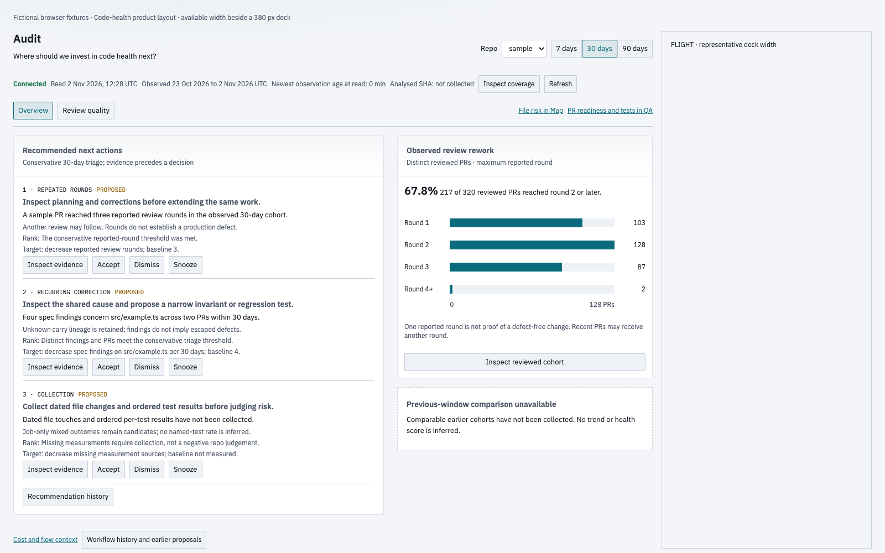
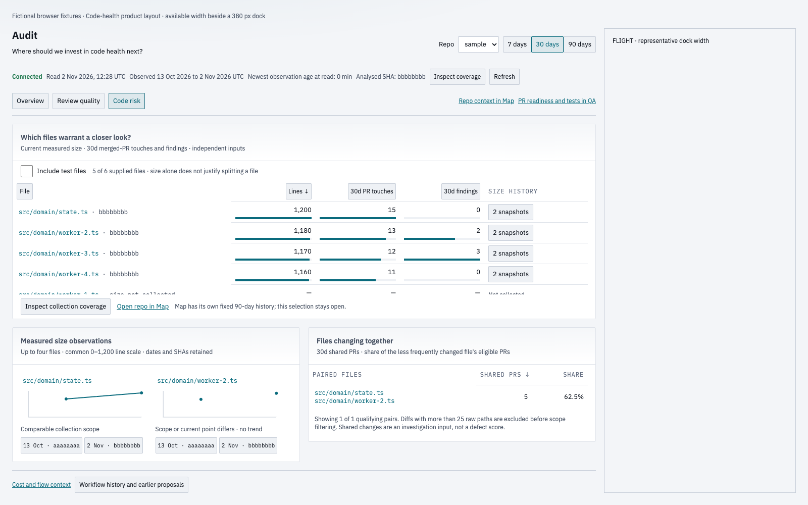

# Code risk QA reference

Rendered source: `df87f99b68b2d2c28f0e08215872b15c4a221ba8`. Baseline: `8c665fb3de38cac8b9d588be10689b0b1113ebbc` (the previous Audit implementation).

These are controlled fictional browser fixtures, using the same API fixture and clock for both sides. Before shows the prior Audit Overview because Code risk did not exist. After shows the new Code risk tab. These are layout and interaction checks; no historical or live QA approval was created.

The approved design is `apps/web/mockups/code-health/index.html`. The implementation keeps the sorted independent file measures, named unknowns, measured size observations and short coupling comparison. Real retained histories replace the mockup's collection gaps only when supplied by the read model.

Design check: pass. All eight required viewport/theme renders have no horizontal page overflow or controls below 24×24. At 1600×1000 beside a 380-pixel dock, the normal layout ends at 976 pixels in both themes. Tables and retained charts scroll visibly; long paths keep a complete accessible name and a two-line display. Empty and 50-file fixtures, keyboard reachability, lazy tab loading, evidence drill-through and retained repo/range selection are checked.

| Viewport | Theme | Before | After |
|---|---|---|---|
| 1280×900 | light | [Before](risk-1280x900-light-before.png) | [After](risk-1280x900-light-after.png) |
| 1280×900 | dark | [Before](risk-1280x900-dark-before.png) | [After](risk-1280x900-dark-after.png) |
| 1600×1000 | light | [Before](risk-1600x1000-light-before.png) | [After](risk-1600x1000-light-after.png) |
| 1600×1000 | dark | [Before](risk-1600x1000-dark-before.png) | [After](risk-1600x1000-dark-after.png) |
| 1920×1080 | light | [Before](risk-1920x1080-light-before.png) | [After](risk-1920x1080-light-after.png) |
| 1920×1080 | dark | [Before](risk-1920x1080-dark-before.png) | [After](risk-1920x1080-dark-after.png) |
| 1600×700 | light | [Before](risk-1600x700-light-before.png) | [After](risk-1600x700-light-after.png) |
| 1600×700 | dark | [Before](risk-1600x700-dark-before.png) | [After](risk-1600x700-dark-after.png) |

Validation: 25 focused unit/integration/browser tests pass, plus lint, workspace typecheck and production build. Sixteen reference renders recorded no page errors. Full CI and the fresh independent review remain merge gates. The machine-readable geometry and source provenance are in [render-checks.json](render-checks.json).
