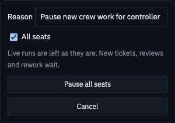
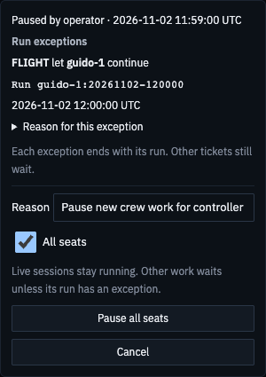

# Crew-pause run exceptions — #1188

The existing pause panel now shows who granted an exception, its actual run, and its grant time.
The operator's original pause remains visible. Its run-specific reason is expandable.

These are controlled fictional fixtures rendered with the actual production component and CSS.
They are not a live Controller check or a full-App integration capture.
No live hub, database, pause, crew process, provider, observed loop or launchd job was accessed or changed.

## Source and capture scope

- Before component/CSS: `15205ba0ff7cb3bbf8bae316ae9f2c5517d66b41`.
- After component/CSS: `d55f5bcd6767fa8e90fa2c65d6d7d80ff41afbdb`, clean worktree at capture.
- The before build substitutes exactly those two files from the baseline commit.
  Both builds use the same current fixture harness and shared client infrastructure.
  This compares the changed panel, not the entire baseline application.
- Fixture clock: `2026-11-02T12:00:00.000Z`; operator pause one minute earlier.
- Actual capture interval: `2026-11-02T18:34:17.512Z` to `2026-11-02T18:34:22.461Z`.
- Fixture SHA-256: `f04f88fcbf32b69f0d210511f595e75614eda399100657404308fe5f9eee3167`.
- Panel images: visible form region at its top scroll position, from a 1600×1000 viewport.
  They do not represent full-page capture or all scrollable rows.
- Viewport images: current visible viewport with the panel open, at the listed dimensions.
  They do not represent full-page capture.
- [Render checks](render-checks.json) retain exact file hashes, capture timestamps, scope and geometry.

## Focused panel before and after

| Scheme | Before | After |
| --- | --- | --- |
| Light | [Before panel](pause-panel-1600x1000-light-before.png) | [After panel](pause-panel-1600x1000-light-after.png) |
| Dark | [Before panel](pause-panel-1600x1000-dark-before.png) | [After panel](pause-panel-1600x1000-dark-after.png) |

## Viewport pairs

| Viewport | Light | Dark |
| --- | --- | --- |
| 1280×900 | [Before](pause-1280x900-light-before.png) / [After](pause-1280x900-light-after.png) | [Before](pause-1280x900-dark-before.png) / [After](pause-1280x900-dark-after.png) |
| 1600×1000 | [Before](pause-1600x1000-light-before.png) / [After](pause-1600x1000-light-after.png) | [Before](pause-1600x1000-dark-before.png) / [After](pause-1600x1000-dark-after.png) |
| 1920×1080 | [Before](pause-1920x1080-light-before.png) / [After](pause-1920x1080-light-after.png) | [Before](pause-1920x1080-dark-before.png) / [After](pause-1920x1080-dark-after.png) |
| 1600×700 | [Before](pause-1600x700-light-before.png) / [After](pause-1600x700-light-after.png) | [Before](pause-1600x700-dark-before.png) / [After](pause-1600x700-dark-after.png) |

The capture waits for the fixture reason, actual run text, and fonts before taking each image.
The baseline audit is absent; the after audit names FLIGHT and the expected run.
All eight after viewport/theme combinations have no page or form horizontal overflow.
After controls meet the 24px minimum. There were zero page errors and zero attempted non-GET requests.

Separate browser regressions cover empty, one, 50 long exception rows and the unavailable state.
The long-list cases check scrolling, reachable controls and no horizontal clipping.
Component cases cover owner/time, reasons, legacy entries, expiry refresh, loading, empty, error and stale-read write refusal.

## Initial local check receipts

The final panel/browser, lint, typecheck, build and capture pack ran after merging current main `15205ba0`.
The backend cases ran before that web-only merge; it changed no server/core source or test files.

These are author-observed local results, not CI or independent review approvals.
No full local suite ran, under the controller's explicit limit. Full CI remains a separate gate.

| Check | Observed result |
| --- | --- |
| Core pause + core FLIGHT + server pause | 20 passed |
| Server queue | 112 passed |
| Server FLIGHT tools | 682 passed |
| Supervisor actual launch boundary | 2 selected passed; 194 unrelated cases skipped |
| Operator pause API | 2 selected passed; 399 unrelated cases skipped |
| Engine pause scheduling | 3 selected passed; 443 unrelated cases skipped |
| CrewPause component, final stale-read change | 10 passed |
| CrewPause browser | 2 passed, including the viewport/theme/row loops |
| Workspace typecheck | All five projects passed |
| Workspace lint | Passed; 40 existing warnings, 7 existing infos; core cycles clear |
| Production web build | Passed |
| Final clean-source paired capture | 16 viewport PNGs + 4 panel PNGs; zero page errors/writes |

Stores in server tests are isolated temporary databases. Supervisor tests use fake CLI processes.
No paid or live seat was started or resumed.

## Review correction and CI fixture repair

The fresh review found that paused older rework could displace a run with the sole active exception.
It could then prevent that eligible run from waking or starting because the paused run retained priority.
The correction filters both shared contender selectors by each contender's own run-specific pause state.
Raw rework detection remains unchanged. No pause scope, owner or grant is changed by selection.
Once the pause clears, the older rework regains its normal priority.

Three new regressions were run against the unchanged selectors at `6eaf7ab7`, with the new tests present.
All three failed for the reported behavior: B was displaced, its wake list stayed empty, and start refused it for paused A.
After the correction, those same cases passed. The separate supervisor project also reran the actual grant and no-op hook cases.
The [red reproduction output](red-reproducer.txt) preserves the original assertions, exception and timings.

| Bounded correction check | Observed result | Wall time |
| --- | --- | --- |
| Engine red reproduction | 2 failed as expected; 446 unrelated skipped | 1.45s |
| Supervisor red reproduction | 1 failed as expected; 196 unrelated skipped | 1.30s |
| Engine green reproduction | 2 passed; 446 unrelated skipped | 1.37s |
| Supervisor priority and launch boundary | 3 passed; 194 unrelated skipped | 2.87s |
| Related engine aside and pause cases | 34 passed; 414 unrelated skipped | 3.92s |
| App, Overview and Setup test files | 282 passed | 4.64s |
| Final correction workspace types and lint | Passed | Separate sequential commands |

The [initial web-core CI job](https://github.com/Luke-Bradford/mission-control/actions/runs/41502011452/job/125471598887)
at `6eaf7ab7` reported 7 failed and 5,425 passed tests.
The seven failures queried a page-wide status or alert, or omitted the pause endpoint fixture.
App, Overview and Setup now provide an explicit successful `null` pause response.
Assertions identify their intended toast, crew status or form error and still check its semantic role.
The 282-case repair run above includes every affected case. This is local evidence; new-head CI remains a separate gate.

The correction changes server selection logic and tests only. Production web source is byte-identical to photographed `d55f5bcd`.
The existing capture source and timestamps remain accurate; no new rendered-behavior claim or capture is added.
All correction checks ran sequentially, at most three workers. No full local suite or live action ran.

## Limits and follow-up

Older seat-only records lack a trustworthy run and per-grant actor. They remain labelled as unbound audit data.
They cannot authorize another run. The code preserves recorded operator scope and does not invent previously removed named seats.
Expired grants disappear from the active reader without rewriting the original persisted record.
Their original grant remains in the hub event log. No new archival cleanup policy is added.

This document is evidence only. A different fresh reviewer and CI must assess the final PR head.
Merge and Update remain with the controller.
