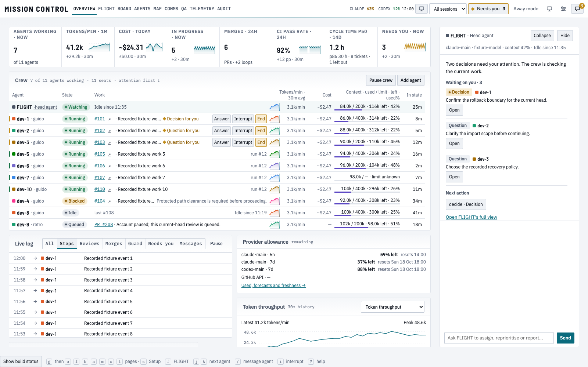

# Overview redesign — actual production evidence

Rendered product: `025859761b2866d58585631d7857b8e3ff872fdd`. Baseline: `15205ba0ff7cb3bbf8bae316ae9f2c5517d66b41` (delivered shell #1370). Delivered main ancestry: `f7ee4e26`. The final evidence-only commit does not change this product source.

These are **actual full-App Chromium captures at 1×**, with production fonts/CSS and controlled fictional API-shaped observations. Both sources receive the same API JSON and frozen 17 October 12:00 UTC clock; actual capture UTC, source/harness/fixture/API/helper/PNG hashes, viewport, theme, rail, state and region are in [render-checks.json](render-checks.json). No live-data or provider-action claim. These are viewport captures; lower panels require real page scrolling. Focused panel images below are labelled separately.

All 58 full-App before/after/diff triplets are retained. The capture also made 84 focused comparisons: 62 actual pairs and 22 explicit baseline absences for new panels. The ledger retains all 142 comparison results / 120 actual pairs / 22 after-only results and all 382 PNG hashes; this gallery retains 288 matrix PNGs (58 full-App triplets, 34 focused triplets and 12 focused after-only views), plus separately labelled keyboard/reviewer evidence. The complete curated tree contains 325 PNGs; the raw source-paired matrix remains 382 PNGs and 142 comparisons. [Whole-tree hashes](artifact-checks.json). A missing baseline component is not replaced by a synthetic before image.

## Primary composition

| Actual viewport | Before | Corrected after | Pixel diff |
| --- | --- | --- | --- |
| 1600 light · open | [before](images/overview-1600x1000-light-expanded-before.png) | [after](images/overview-1600x1000-light-expanded-after.png) | [diff](images/overview-1600x1000-light-expanded-diff.png) |
| 1920 dark · folded | [before](images/overview-1920x1080-dark-default-before.png) | [after](images/overview-1920x1080-dark-default-after.png) | [diff](images/overview-1920x1080-dark-default-diff.png) |
| 1280 dark · open | [before](images/overview-1280x900-dark-expanded-before.png) | [after](images/overview-1280x900-dark-expanded-after.png) | [diff](images/overview-1280x900-dark-expanded-diff.png) |
| 1600 ×700 dark · open | [before](images/overview-1600x700-dark-expanded-before.png) | [after](images/overview-1600x700-dark-expanded-after.png) | [diff](images/overview-1600x700-dark-expanded-diff.png) |
| 9 seats + 2 observed loops · 1600 open | [before](images/mixed-1600x1000-light-expanded-before.png) | [after](images/mixed-1600x1000-light-expanded-after.png) | [diff](images/mixed-1600x1000-light-expanded-diff.png) |

## Table and content-access observations

The roster uses 128px Agent, 80px State, at least 260px Work, 96px rate, 64px Cost, 178px Context and 52px age with 8px gaps. Numeric headings/readings align right. Full-width Work no longer consumes 1100px for a short title. Initial narrow views deliberately scroll the 1050px comparison; the pinned identity remains visible and focus is revealed beyond it. Ticket/PR identifiers, Answer/Interrupt/End and Add/Agent/Map/Board routes remain reachable. Prose may shorten; keyboard-opened evidence preserves full text.

| Viewport | Rail | Actual Work width | Context width | Retained seats |
| --- | --- | --- | --- | --- |
| 1280 × 900 | folded | 505px | 178px | 11 |
| 1280 × 900 | open | 388px | 178px | 11 |
| 1600 × 1000 | folded | 449px | 178px | 11 |
| 1600 × 1000 | open | 469px | 178px | 11 |
| 1920 × 1080 | folded | 521px | 178px | 11 |
| 1920 × 1080 | open | 437px | 178px | 11 |

| Surface | Actual inspection and access result | Evidence |
| --- | --- | --- |
| Crew at 1280, rail open | Comparison needs horizontal scroll; visible cue names it. Agent identity remains pinned. Real ArrowRight and Tab expose Context, the final column, ticket/GitHub and all row actions. This is not a claim that every column is initially visible. | [long Crew](images/long-1280x1000-dark-expanded-agentsP-after.png) · [corrected independent receipt](corrected-025-review-receipt.json) |
| Crew at 1600 / 1920 | All 11 normal seats fit the bounded 32px roster; normal first screen also contains live events. The separate mixed fixture proves 9 configured seats + 2 observed loops and unchanged session filtering. At 1600 × 700 the actual-overflow cue states retained and fully visible counts; 50 rows remain keyboard-scrollable. | [1600 Crew](images/overview-1600x1000-light-expanded-agentsP-after.png) · [mixed](images/mixed-1600x1000-light-expanded-agentsP-after.png) |
| Allowance table | Used, remaining, reset, forecast, source/read-age and retry remain separate native columns. At 1600 open the 760px table needs horizontal scrolling; the corrected visible cue and named focusable region expose the final forecast/freshness column. At 1920 the primary column shows it without horizontal pan. Unknown account windows remain explicit. | [1600 table](images/overview-1600x1000-light-expanded-quotaP-after.png) · [1920 table](images/overview-1920x1080-light-expanded-quotaP-after.png) |
| Timeline/evidence | Real measured span kind/duration labels and distinct instantaneous tool diamonds use a shared window. UTC interval disclosure and compact actual Next actions remain reachable; no duration inferred for a tool-start instant. | [Timeline](images/overview-1920x1080-light-expanded-timelineP-after.png) |
| Measured histories | Select existing cached token/cost/inflight/CI/Needs-you series without a read. Labelled axes/latest/peak/window distinguish zero from missing samples. Recorded-value tables expose every raw point and timestamp through native keyboard disclosure/scrolling. Nonzero sub-cent USD/min stays nonzero. | [sub-cent cost](images/subcent-1600x1000-light-expanded-overviewHistoryP-after.png) · [keyboard history](images/keyboard-history-subcent-light.png) |
| Machine | Independent lower stack cannot set Crew/log height. CPU/RAM are percent with used/total GiB alongside; disk graph is GiB free. Visible latest/peak/window and real gaps accompany raw observations; process/test/slot/admission/transcript/test-lock facts are retained. | [Machine](images/overview-1920x1080-light-expanded-machP-after.png) |
| Pipeline | Secondary after primary work/capacity. Heading/count/example baselines align, quiet lanes are compact and total/not-shown counts are explicit. True ticket/assignee and Board access remain. | [Pipeline](images/overview-1920x1080-light-expanded-pipelineP-after.png) |

## Review and rework remain visible

The earlier Pipeline promotion and tall primary Timeline/Machine stack were author choices rejected by the operator. The current layout follows the later offered redesign; earlier 2cab / ed31 frames are not relabelled approved.

- [Original 06b clock failure](http://127.0.0.1:7420/qa?repo=mission-control&pr=1374&report=e09e5559cd2a25eb65a554df2d1363a83edbdccc69d8b9aefae4ca60d127bf9b): corrected in 2cab; isolated clock/no-fetch guards retained.
- [Operator/layout rejection at 2cab](http://127.0.0.1:7420/qa?repo=mission-control&pr=1374&report=29aa2ffc51ad64aecdc32da3183d9d1c6ef47dc0e316589c6b0ed72726df9661): Connecting-state pairs are historical, not settled acceptance.
- [Fresh redesign failed QA at ed31](http://127.0.0.1:7420/qa?repo=mission-control&pr=1374&report=cb84f95d8203f5263fe9a60337b621bf9f8c5db13d744aa8714052c3a276d4de): two Important access findings. Source artifact d0d04d82 and the original 382 PNG private archive remain unchanged. [Failed focus receipt](failed-ed31-review-receipt.json), [failed allowance receipt](failed-allowance-ed31-review-receipt.json), and [same-reviewer corrected receipt](corrected-025-review-receipt.json) preserve source/read/focus facts. [Access artifact hashes](access-checks.json).
- [Failed CI 41518774532](https://github.com/Luke-Bradford/mission-control/actions/runs/41518774532) and [failed ed31 CI 41539460141](https://github.com/Luke-Bradford/mission-control/actions/runs/41539460141) remain recorded. The latter had 5470 passed / 3 failed; source 025 addresses native quota forecast scoping, account title and HUD-token fallbacks. No timeout, token guard or content-access assertion was weakened.

The final correction independently rechecks both themes: panned #101 moves from x49 under the identity to visible x153; subsequent GitHub/Answer/Interrupt/End all paint visibly with focus. The allowance cue is visible at 1600 open; all three independent cases keep 22 reads and zero page errors. This is the same whole-branch review followed by a narrow correction check; final evidence provenance is checked separately.

| Corrected finding | Independent failed source ed31 | Independent corrected source 025 |
| --- | --- | --- |
| Ticket focus hidden after a pan · 1280 × 900 dark | [failed](images/failed-ed31-1280x900-dark-default-work-focus-after-pan.png) | [ticket visibly focused](images/corrected-025-1280x900-dark-default-focus-0.png) · [End visibly focused](images/corrected-025-1280x900-dark-default-focus-4.png) |
| Missing allowance overflow cue · 1600 × 1000 light | [failed](images/failed-allowance-ed31-1600x1000-light-default-missing-overflow-cue.png) | [visible cue](images/corrected-025-1600x1000-light-default-visible-overflow-cue.png) |

The final [source-bound keyboard supplement](supplement-checks.json) contains four additional read-only cases and eight after-only images. Both themes prove every rightmost forecast/source text node is inside the allowance viewport, and native End reaches the 50th retained row with a visibly focused Agent route. Reads stay 22 → 22 and writes are refused. These are supplemental access views, not extra baseline pairs.

| Final-source keyboard proof | Light | Dark |
| --- | --- | --- |
| Allowance, after native horizontal pan · full App | [viewport](images/supplement-allowance-light-viewport.png) | [viewport](images/supplement-allowance-dark-viewport.png) |
| Allowance, actual rightmost column · focused panel | [panel](images/supplement-allowance-light-panel.png) | [panel](images/supplement-allowance-dark-panel.png) |
| Fifty seats, native End / final Agent route · full App | [viewport](images/supplement-many-light-viewport.png) | [viewport](images/supplement-many-dark-viewport.png) |
| Fifty seats, visibly focused last row · focused panel | [panel](images/supplement-many-light-panel.png) | [panel](images/supplement-many-dark-panel.png) |

The auxiliary first pan predicate rejected a 0.375px cell-padding edge after successful scrolling and timed out at its default 30s. That exceeded its intended bound; it is retained as a failed probe, not accepted access evidence. The [bounded diagnostic](aux-pan-diagnostic.json) records the exact geometry. The final proof tests actual text-node bounds and painted focus instead. [Executed supplement helper](access-supplement.ts); raw failures and successful output are in the checks ledger.

## Checks and design reference

[local-checks.json](local-checks.json) retains actual staged commands/results and red output hashes. 377 focused cases passed at the earlier integrated stage; 146 affected Machine/history/layout and 107 row/clock/render/fetch guard cases subsequently passed. The broad browser run was 25/26, followed by the targeted endpoint corrections; the final 2-case browser selection proves both-theme access plus 24 settled normal views. This is not one invented final 26/26 run. Final types/lint/build pass. [Source 025 CI](https://github.com/Luke-Bradford/mission-control/actions/runs/41542173831) finished with 5472 web/core cases passed and one test-selector failure: the restored account title became the first `[title]` in its account row. Test-only successor `613187c8` scopes the same 7d hover evidence and additionally checks the visible read age; all 129 Overview cases pass. Product/runtime source remains `02585976`. Final-head CI is pending and is recorded by the controller before merge.

The exact [offered HTML](offered-design.html) and [contemporaneous inventory](offered-content-inventory.md) are copied unchanged from design 9111bd62, with [hashes/scope](offered-design-checks.json). HTML SHA256 is `0ab156e4344e756daa36d30b7520d1138b2c8ca5bc283c9efc420c495e4c5917`. Their fictional standalone status and historical paused-CI language belong to that design checkpoint; production images above are separate. [Executed capture helper](capture.ts) is byte-identical to the hash in the render ledger.

## Complete retained viewport matrix

| Scenario / viewport / theme / rail | Before | Corrected after | Diff |
| --- | --- | --- | --- |
| overview-1280x900-light-default | [before](images/overview-1280x900-light-default-before.png) | [after](images/overview-1280x900-light-default-after.png) | [diff](images/overview-1280x900-light-default-diff.png) |
| overview-1280x900-light-expanded | [before](images/overview-1280x900-light-expanded-before.png) | [after](images/overview-1280x900-light-expanded-after.png) | [diff](images/overview-1280x900-light-expanded-diff.png) |
| overview-1440x900-light-default | [before](images/overview-1440x900-light-default-before.png) | [after](images/overview-1440x900-light-default-after.png) | [diff](images/overview-1440x900-light-default-diff.png) |
| overview-1440x900-light-expanded | [before](images/overview-1440x900-light-expanded-before.png) | [after](images/overview-1440x900-light-expanded-after.png) | [diff](images/overview-1440x900-light-expanded-diff.png) |
| overview-1600x1000-light-default | [before](images/overview-1600x1000-light-default-before.png) | [after](images/overview-1600x1000-light-default-after.png) | [diff](images/overview-1600x1000-light-default-diff.png) |
| overview-1600x1000-light-expanded | [before](images/overview-1600x1000-light-expanded-before.png) | [after](images/overview-1600x1000-light-expanded-after.png) | [diff](images/overview-1600x1000-light-expanded-diff.png) |
| overview-1920x1080-light-default | [before](images/overview-1920x1080-light-default-before.png) | [after](images/overview-1920x1080-light-default-after.png) | [diff](images/overview-1920x1080-light-default-diff.png) |
| overview-1920x1080-light-expanded | [before](images/overview-1920x1080-light-expanded-before.png) | [after](images/overview-1920x1080-light-expanded-after.png) | [diff](images/overview-1920x1080-light-expanded-diff.png) |
| overview-2560x1440-light-folded | [before](images/overview-2560x1440-light-folded-before.png) | [after](images/overview-2560x1440-light-folded-after.png) | [diff](images/overview-2560x1440-light-folded-diff.png) |
| overview-2560x1440-light-expanded | [before](images/overview-2560x1440-light-expanded-before.png) | [after](images/overview-2560x1440-light-expanded-after.png) | [diff](images/overview-2560x1440-light-expanded-diff.png) |
| overview-1600x700-light-default | [before](images/overview-1600x700-light-default-before.png) | [after](images/overview-1600x700-light-default-after.png) | [diff](images/overview-1600x700-light-default-diff.png) |
| overview-1600x700-light-expanded | [before](images/overview-1600x700-light-expanded-before.png) | [after](images/overview-1600x700-light-expanded-after.png) | [diff](images/overview-1600x700-light-expanded-diff.png) |
| long-1280x1000-light-default | [before](images/long-1280x1000-light-default-before.png) | [after](images/long-1280x1000-light-default-after.png) | [diff](images/long-1280x1000-light-default-diff.png) |
| long-1280x1000-light-expanded | [before](images/long-1280x1000-light-expanded-before.png) | [after](images/long-1280x1000-light-expanded-after.png) | [diff](images/long-1280x1000-light-expanded-diff.png) |
| long-1600x1000-light-default | [before](images/long-1600x1000-light-default-before.png) | [after](images/long-1600x1000-light-default-after.png) | [diff](images/long-1600x1000-light-default-diff.png) |
| long-1600x1000-light-expanded | [before](images/long-1600x1000-light-expanded-before.png) | [after](images/long-1600x1000-light-expanded-after.png) | [diff](images/long-1600x1000-light-expanded-diff.png) |
| long-1920x1000-light-default | [before](images/long-1920x1000-light-default-before.png) | [after](images/long-1920x1000-light-default-after.png) | [diff](images/long-1920x1000-light-default-diff.png) |
| long-1920x1000-light-expanded | [before](images/long-1920x1000-light-expanded-before.png) | [after](images/long-1920x1000-light-expanded-after.png) | [diff](images/long-1920x1000-light-expanded-diff.png) |
| state-empty-1600x700-light | [before](images/state-empty-1600x700-light-before.png) | [after](images/state-empty-1600x700-light-after.png) | [diff](images/state-empty-1600x700-light-diff.png) |
| state-one-1600x700-light | [before](images/state-one-1600x700-light-before.png) | [after](images/state-one-1600x700-light-after.png) | [diff](images/state-one-1600x700-light-diff.png) |
| state-many-1600x700-light | [before](images/state-many-1600x700-light-before.png) | [after](images/state-many-1600x700-light-after.png) | [diff](images/state-many-1600x700-light-diff.png) |
| state-long-1600x700-light | [before](images/state-long-1600x700-light-before.png) | [after](images/state-long-1600x700-light-after.png) | [diff](images/state-long-1600x700-light-diff.png) |
| state-loading-1600x700-light | [before](images/state-loading-1600x700-light-before.png) | [after](images/state-loading-1600x700-light-after.png) | [diff](images/state-loading-1600x700-light-diff.png) |
| state-error-1600x700-light | [before](images/state-error-1600x700-light-before.png) | [after](images/state-error-1600x700-light-after.png) | [diff](images/state-error-1600x700-light-diff.png) |
| state-stale-1600x700-light | [before](images/state-stale-1600x700-light-before.png) | [after](images/state-stale-1600x700-light-after.png) | [diff](images/state-stale-1600x700-light-diff.png) |
| state-disconnected-1600x700-light | [before](images/state-disconnected-1600x700-light-before.png) | [after](images/state-disconnected-1600x700-light-after.png) | [diff](images/state-disconnected-1600x700-light-diff.png) |
| overview-1280x900-dark-default | [before](images/overview-1280x900-dark-default-before.png) | [after](images/overview-1280x900-dark-default-after.png) | [diff](images/overview-1280x900-dark-default-diff.png) |
| overview-1280x900-dark-expanded | [before](images/overview-1280x900-dark-expanded-before.png) | [after](images/overview-1280x900-dark-expanded-after.png) | [diff](images/overview-1280x900-dark-expanded-diff.png) |
| overview-1440x900-dark-default | [before](images/overview-1440x900-dark-default-before.png) | [after](images/overview-1440x900-dark-default-after.png) | [diff](images/overview-1440x900-dark-default-diff.png) |
| overview-1440x900-dark-expanded | [before](images/overview-1440x900-dark-expanded-before.png) | [after](images/overview-1440x900-dark-expanded-after.png) | [diff](images/overview-1440x900-dark-expanded-diff.png) |
| overview-1600x1000-dark-default | [before](images/overview-1600x1000-dark-default-before.png) | [after](images/overview-1600x1000-dark-default-after.png) | [diff](images/overview-1600x1000-dark-default-diff.png) |
| overview-1600x1000-dark-expanded | [before](images/overview-1600x1000-dark-expanded-before.png) | [after](images/overview-1600x1000-dark-expanded-after.png) | [diff](images/overview-1600x1000-dark-expanded-diff.png) |
| overview-1920x1080-dark-default | [before](images/overview-1920x1080-dark-default-before.png) | [after](images/overview-1920x1080-dark-default-after.png) | [diff](images/overview-1920x1080-dark-default-diff.png) |
| overview-1920x1080-dark-expanded | [before](images/overview-1920x1080-dark-expanded-before.png) | [after](images/overview-1920x1080-dark-expanded-after.png) | [diff](images/overview-1920x1080-dark-expanded-diff.png) |
| overview-2560x1440-dark-folded | [before](images/overview-2560x1440-dark-folded-before.png) | [after](images/overview-2560x1440-dark-folded-after.png) | [diff](images/overview-2560x1440-dark-folded-diff.png) |
| overview-2560x1440-dark-expanded | [before](images/overview-2560x1440-dark-expanded-before.png) | [after](images/overview-2560x1440-dark-expanded-after.png) | [diff](images/overview-2560x1440-dark-expanded-diff.png) |
| overview-1600x700-dark-default | [before](images/overview-1600x700-dark-default-before.png) | [after](images/overview-1600x700-dark-default-after.png) | [diff](images/overview-1600x700-dark-default-diff.png) |
| overview-1600x700-dark-expanded | [before](images/overview-1600x700-dark-expanded-before.png) | [after](images/overview-1600x700-dark-expanded-after.png) | [diff](images/overview-1600x700-dark-expanded-diff.png) |
| long-1280x1000-dark-default | [before](images/long-1280x1000-dark-default-before.png) | [after](images/long-1280x1000-dark-default-after.png) | [diff](images/long-1280x1000-dark-default-diff.png) |
| long-1280x1000-dark-expanded | [before](images/long-1280x1000-dark-expanded-before.png) | [after](images/long-1280x1000-dark-expanded-after.png) | [diff](images/long-1280x1000-dark-expanded-diff.png) |
| long-1600x1000-dark-default | [before](images/long-1600x1000-dark-default-before.png) | [after](images/long-1600x1000-dark-default-after.png) | [diff](images/long-1600x1000-dark-default-diff.png) |
| long-1600x1000-dark-expanded | [before](images/long-1600x1000-dark-expanded-before.png) | [after](images/long-1600x1000-dark-expanded-after.png) | [diff](images/long-1600x1000-dark-expanded-diff.png) |
| long-1920x1000-dark-default | [before](images/long-1920x1000-dark-default-before.png) | [after](images/long-1920x1000-dark-default-after.png) | [diff](images/long-1920x1000-dark-default-diff.png) |
| long-1920x1000-dark-expanded | [before](images/long-1920x1000-dark-expanded-before.png) | [after](images/long-1920x1000-dark-expanded-after.png) | [diff](images/long-1920x1000-dark-expanded-diff.png) |
| state-empty-1600x700-dark | [before](images/state-empty-1600x700-dark-before.png) | [after](images/state-empty-1600x700-dark-after.png) | [diff](images/state-empty-1600x700-dark-diff.png) |
| state-one-1600x700-dark | [before](images/state-one-1600x700-dark-before.png) | [after](images/state-one-1600x700-dark-after.png) | [diff](images/state-one-1600x700-dark-diff.png) |
| state-many-1600x700-dark | [before](images/state-many-1600x700-dark-before.png) | [after](images/state-many-1600x700-dark-after.png) | [diff](images/state-many-1600x700-dark-diff.png) |
| state-long-1600x700-dark | [before](images/state-long-1600x700-dark-before.png) | [after](images/state-long-1600x700-dark-after.png) | [diff](images/state-long-1600x700-dark-diff.png) |
| state-loading-1600x700-dark | [before](images/state-loading-1600x700-dark-before.png) | [after](images/state-loading-1600x700-dark-after.png) | [diff](images/state-loading-1600x700-dark-diff.png) |
| state-error-1600x700-dark | [before](images/state-error-1600x700-dark-before.png) | [after](images/state-error-1600x700-dark-after.png) | [diff](images/state-error-1600x700-dark-diff.png) |
| state-stale-1600x700-dark | [before](images/state-stale-1600x700-dark-before.png) | [after](images/state-stale-1600x700-dark-after.png) | [diff](images/state-stale-1600x700-dark-diff.png) |
| state-disconnected-1600x700-dark | [before](images/state-disconnected-1600x700-dark-before.png) | [after](images/state-disconnected-1600x700-dark-after.png) | [diff](images/state-disconnected-1600x700-dark-diff.png) |
| mixed-1600x1000-light-default | [before](images/mixed-1600x1000-light-default-before.png) | [after](images/mixed-1600x1000-light-default-after.png) | [diff](images/mixed-1600x1000-light-default-diff.png) |
| mixed-1600x1000-light-expanded | [before](images/mixed-1600x1000-light-expanded-before.png) | [after](images/mixed-1600x1000-light-expanded-after.png) | [diff](images/mixed-1600x1000-light-expanded-diff.png) |
| subcent-1600x1000-light-expanded | [before](images/subcent-1600x1000-light-expanded-before.png) | [after](images/subcent-1600x1000-light-expanded-after.png) | [diff](images/subcent-1600x1000-light-expanded-diff.png) |
| mixed-1600x1000-dark-default | [before](images/mixed-1600x1000-dark-default-before.png) | [after](images/mixed-1600x1000-dark-default-after.png) | [diff](images/mixed-1600x1000-dark-default-diff.png) |
| mixed-1600x1000-dark-expanded | [before](images/mixed-1600x1000-dark-expanded-before.png) | [after](images/mixed-1600x1000-dark-expanded-after.png) | [diff](images/mixed-1600x1000-dark-expanded-diff.png) |
| subcent-1600x1000-dark-expanded | [before](images/subcent-1600x1000-dark-expanded-before.png) | [after](images/subcent-1600x1000-dark-expanded-after.png) | [diff](images/subcent-1600x1000-dark-expanded-diff.png) |

## Focused regions retained

| Source-matched region | Before | Corrected after | Diff |
| --- | --- | --- | --- |
| overview-1280x900-light-expanded-overview-metrics | [before](images/overview-1280x900-light-expanded-overview-metrics-before.png) | [after](images/overview-1280x900-light-expanded-overview-metrics-after.png) | [diff](images/overview-1280x900-light-expanded-overview-metrics-diff.png) |
| overview-1280x900-light-expanded-agentsP | [before](images/overview-1280x900-light-expanded-agentsP-before.png) | [after](images/overview-1280x900-light-expanded-agentsP-after.png) | [diff](images/overview-1280x900-light-expanded-agentsP-diff.png) |
| overview-1600x1000-light-expanded-overview-metrics | [before](images/overview-1600x1000-light-expanded-overview-metrics-before.png) | [after](images/overview-1600x1000-light-expanded-overview-metrics-after.png) | [diff](images/overview-1600x1000-light-expanded-overview-metrics-diff.png) |
| overview-1600x1000-light-expanded-agentsP | [before](images/overview-1600x1000-light-expanded-agentsP-before.png) | [after](images/overview-1600x1000-light-expanded-agentsP-after.png) | [diff](images/overview-1600x1000-light-expanded-agentsP-diff.png) |
| overview-1600x1000-light-expanded-quotaP | [before](images/overview-1600x1000-light-expanded-quotaP-before.png) | [after](images/overview-1600x1000-light-expanded-quotaP-after.png) | [diff](images/overview-1600x1000-light-expanded-quotaP-diff.png) |
| overview-1600x1000-light-expanded-quotaSummaryP | Absent at baseline; see full-App pair | [after](images/overview-1600x1000-light-expanded-quotaSummaryP-after.png) | Absent at baseline; see full-App pair |
| overview-1600x1000-light-expanded-overviewHistoryP | Absent at baseline; see full-App pair | [after](images/overview-1600x1000-light-expanded-overviewHistoryP-after.png) | Absent at baseline; see full-App pair |
| overview-1920x1080-light-expanded-overview-metrics | [before](images/overview-1920x1080-light-expanded-overview-metrics-before.png) | [after](images/overview-1920x1080-light-expanded-overview-metrics-after.png) | [diff](images/overview-1920x1080-light-expanded-overview-metrics-diff.png) |
| overview-1920x1080-light-expanded-agentsP | [before](images/overview-1920x1080-light-expanded-agentsP-before.png) | [after](images/overview-1920x1080-light-expanded-agentsP-after.png) | [diff](images/overview-1920x1080-light-expanded-agentsP-diff.png) |
| overview-1920x1080-light-expanded-quotaP | [before](images/overview-1920x1080-light-expanded-quotaP-before.png) | [after](images/overview-1920x1080-light-expanded-quotaP-after.png) | [diff](images/overview-1920x1080-light-expanded-quotaP-diff.png) |
| overview-1920x1080-light-expanded-quotaSummaryP | Absent at baseline; see full-App pair | [after](images/overview-1920x1080-light-expanded-quotaSummaryP-after.png) | Absent at baseline; see full-App pair |
| overview-1920x1080-light-expanded-overviewHistoryP | Absent at baseline; see full-App pair | [after](images/overview-1920x1080-light-expanded-overviewHistoryP-after.png) | Absent at baseline; see full-App pair |
| overview-1920x1080-light-expanded-pipelineP | [before](images/overview-1920x1080-light-expanded-pipelineP-before.png) | [after](images/overview-1920x1080-light-expanded-pipelineP-after.png) | [diff](images/overview-1920x1080-light-expanded-pipelineP-diff.png) |
| overview-1920x1080-light-expanded-timelineP | [before](images/overview-1920x1080-light-expanded-timelineP-before.png) | [after](images/overview-1920x1080-light-expanded-timelineP-after.png) | [diff](images/overview-1920x1080-light-expanded-timelineP-diff.png) |
| overview-1920x1080-light-expanded-machP | [before](images/overview-1920x1080-light-expanded-machP-before.png) | [after](images/overview-1920x1080-light-expanded-machP-after.png) | [diff](images/overview-1920x1080-light-expanded-machP-diff.png) |
| overview-1920x1080-light-expanded-overviewNextP | Absent at baseline; see full-App pair | [after](images/overview-1920x1080-light-expanded-overviewNextP-after.png) | Absent at baseline; see full-App pair |
| long-1280x1000-light-expanded-agentsP | [before](images/long-1280x1000-light-expanded-agentsP-before.png) | [after](images/long-1280x1000-light-expanded-agentsP-after.png) | [diff](images/long-1280x1000-light-expanded-agentsP-diff.png) |
| long-1600x1000-light-expanded-agentsP | [before](images/long-1600x1000-light-expanded-agentsP-before.png) | [after](images/long-1600x1000-light-expanded-agentsP-after.png) | [diff](images/long-1600x1000-light-expanded-agentsP-diff.png) |
| long-1920x1000-light-expanded-agentsP | [before](images/long-1920x1000-light-expanded-agentsP-before.png) | [after](images/long-1920x1000-light-expanded-agentsP-after.png) | [diff](images/long-1920x1000-light-expanded-agentsP-diff.png) |
| state-long-1600x700-light-agentsP | [before](images/state-long-1600x700-light-agentsP-before.png) | [after](images/state-long-1600x700-light-agentsP-after.png) | [diff](images/state-long-1600x700-light-agentsP-diff.png) |
| overview-1280x900-dark-expanded-overview-metrics | [before](images/overview-1280x900-dark-expanded-overview-metrics-before.png) | [after](images/overview-1280x900-dark-expanded-overview-metrics-after.png) | [diff](images/overview-1280x900-dark-expanded-overview-metrics-diff.png) |
| overview-1280x900-dark-expanded-agentsP | [before](images/overview-1280x900-dark-expanded-agentsP-before.png) | [after](images/overview-1280x900-dark-expanded-agentsP-after.png) | [diff](images/overview-1280x900-dark-expanded-agentsP-diff.png) |
| overview-1600x1000-dark-expanded-overview-metrics | [before](images/overview-1600x1000-dark-expanded-overview-metrics-before.png) | [after](images/overview-1600x1000-dark-expanded-overview-metrics-after.png) | [diff](images/overview-1600x1000-dark-expanded-overview-metrics-diff.png) |
| overview-1600x1000-dark-expanded-agentsP | [before](images/overview-1600x1000-dark-expanded-agentsP-before.png) | [after](images/overview-1600x1000-dark-expanded-agentsP-after.png) | [diff](images/overview-1600x1000-dark-expanded-agentsP-diff.png) |
| overview-1600x1000-dark-expanded-quotaP | [before](images/overview-1600x1000-dark-expanded-quotaP-before.png) | [after](images/overview-1600x1000-dark-expanded-quotaP-after.png) | [diff](images/overview-1600x1000-dark-expanded-quotaP-diff.png) |
| overview-1600x1000-dark-expanded-quotaSummaryP | Absent at baseline; see full-App pair | [after](images/overview-1600x1000-dark-expanded-quotaSummaryP-after.png) | Absent at baseline; see full-App pair |
| overview-1600x1000-dark-expanded-overviewHistoryP | Absent at baseline; see full-App pair | [after](images/overview-1600x1000-dark-expanded-overviewHistoryP-after.png) | Absent at baseline; see full-App pair |
| overview-1920x1080-dark-expanded-overview-metrics | [before](images/overview-1920x1080-dark-expanded-overview-metrics-before.png) | [after](images/overview-1920x1080-dark-expanded-overview-metrics-after.png) | [diff](images/overview-1920x1080-dark-expanded-overview-metrics-diff.png) |
| overview-1920x1080-dark-expanded-agentsP | [before](images/overview-1920x1080-dark-expanded-agentsP-before.png) | [after](images/overview-1920x1080-dark-expanded-agentsP-after.png) | [diff](images/overview-1920x1080-dark-expanded-agentsP-diff.png) |
| overview-1920x1080-dark-expanded-quotaP | [before](images/overview-1920x1080-dark-expanded-quotaP-before.png) | [after](images/overview-1920x1080-dark-expanded-quotaP-after.png) | [diff](images/overview-1920x1080-dark-expanded-quotaP-diff.png) |
| overview-1920x1080-dark-expanded-quotaSummaryP | Absent at baseline; see full-App pair | [after](images/overview-1920x1080-dark-expanded-quotaSummaryP-after.png) | Absent at baseline; see full-App pair |
| overview-1920x1080-dark-expanded-overviewHistoryP | Absent at baseline; see full-App pair | [after](images/overview-1920x1080-dark-expanded-overviewHistoryP-after.png) | Absent at baseline; see full-App pair |
| overview-1920x1080-dark-expanded-pipelineP | [before](images/overview-1920x1080-dark-expanded-pipelineP-before.png) | [after](images/overview-1920x1080-dark-expanded-pipelineP-after.png) | [diff](images/overview-1920x1080-dark-expanded-pipelineP-diff.png) |
| overview-1920x1080-dark-expanded-timelineP | [before](images/overview-1920x1080-dark-expanded-timelineP-before.png) | [after](images/overview-1920x1080-dark-expanded-timelineP-after.png) | [diff](images/overview-1920x1080-dark-expanded-timelineP-diff.png) |
| overview-1920x1080-dark-expanded-machP | [before](images/overview-1920x1080-dark-expanded-machP-before.png) | [after](images/overview-1920x1080-dark-expanded-machP-after.png) | [diff](images/overview-1920x1080-dark-expanded-machP-diff.png) |
| overview-1920x1080-dark-expanded-overviewNextP | Absent at baseline; see full-App pair | [after](images/overview-1920x1080-dark-expanded-overviewNextP-after.png) | Absent at baseline; see full-App pair |
| long-1280x1000-dark-expanded-agentsP | [before](images/long-1280x1000-dark-expanded-agentsP-before.png) | [after](images/long-1280x1000-dark-expanded-agentsP-after.png) | [diff](images/long-1280x1000-dark-expanded-agentsP-diff.png) |
| long-1600x1000-dark-expanded-agentsP | [before](images/long-1600x1000-dark-expanded-agentsP-before.png) | [after](images/long-1600x1000-dark-expanded-agentsP-after.png) | [diff](images/long-1600x1000-dark-expanded-agentsP-diff.png) |
| long-1920x1000-dark-expanded-agentsP | [before](images/long-1920x1000-dark-expanded-agentsP-before.png) | [after](images/long-1920x1000-dark-expanded-agentsP-after.png) | [diff](images/long-1920x1000-dark-expanded-agentsP-diff.png) |
| state-long-1600x700-dark-agentsP | [before](images/state-long-1600x700-dark-agentsP-before.png) | [after](images/state-long-1600x700-dark-agentsP-after.png) | [diff](images/state-long-1600x700-dark-agentsP-diff.png) |
| mixed-1600x1000-light-default-agentsP | [before](images/mixed-1600x1000-light-default-agentsP-before.png) | [after](images/mixed-1600x1000-light-default-agentsP-after.png) | [diff](images/mixed-1600x1000-light-default-agentsP-diff.png) |
| mixed-1600x1000-light-expanded-agentsP | [before](images/mixed-1600x1000-light-expanded-agentsP-before.png) | [after](images/mixed-1600x1000-light-expanded-agentsP-after.png) | [diff](images/mixed-1600x1000-light-expanded-agentsP-diff.png) |
| subcent-1600x1000-light-expanded-overviewHistoryP | Absent at baseline; see full-App pair | [after](images/subcent-1600x1000-light-expanded-overviewHistoryP-after.png) | Absent at baseline; see full-App pair |
| mixed-1600x1000-dark-default-agentsP | [before](images/mixed-1600x1000-dark-default-agentsP-before.png) | [after](images/mixed-1600x1000-dark-default-agentsP-after.png) | [diff](images/mixed-1600x1000-dark-default-agentsP-diff.png) |
| mixed-1600x1000-dark-expanded-agentsP | [before](images/mixed-1600x1000-dark-expanded-agentsP-before.png) | [after](images/mixed-1600x1000-dark-expanded-agentsP-after.png) | [diff](images/mixed-1600x1000-dark-expanded-agentsP-diff.png) |
| subcent-1600x1000-dark-expanded-overviewHistoryP | Absent at baseline; see full-App pair | [after](images/subcent-1600x1000-dark-expanded-overviewHistoryP-after.png) | Absent at baseline; see full-App pair |
