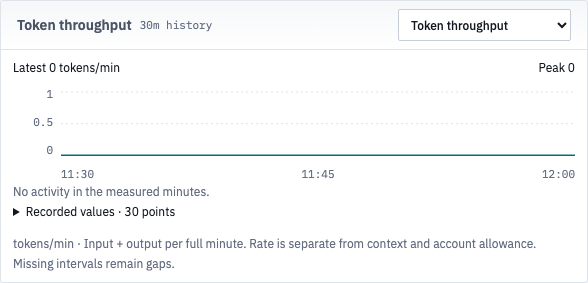

# Overview history ticks — #1379

Rendered source: `99e45192ca835348162ec6cebfdb51e7bb883023`. Baseline: `6f0df12e1112ace4bae4fa869117b3464e58f4a7`. A later artifact commit only retains this evidence.

The axis now keeps fractional midpoint values for small token/count scales. Latest, peak, percentage, sub-cent USD and recorded-value formatting stay unchanged. Plot positions, source observations and page hierarchy stay unchanged.

Actual production App, fonts and CSS were captured at 1×, 1920 × 1080 with FLIGHT folded, in light and dark. Fourteen scenario/theme cases produce 14 context pairs and 14 matching focused-panel pairs: 28 actual pairs / 84 PNGs. Actual captures span **2026-11-02T23:59:20.875000Z–2026-11-02T23:59:31.438000Z**; the browser fixture clock is separately frozen at `2026-10-17T12:00:00.000Z`. The paired captures are dated 2 November UTC. Independent verification completed at `2026-11-03T00:00:21.835Z`; the evidence work crosses midnight, while each receipt keeps its actual date.

Both sides receive identical controlled fictional APIs. The mixed fixture retains nine seats and two observed loops; token scenarios distribute the recorded minute values over the crew source. The helper waits for loaded quota, roster, loops and history before selecting a measure and capturing. It refuses writes and checks no extra selection reads, page errors or horizontal overflow. These are not live observations.

[Render ledger](render-checks.json) binds both sources, API/harness/fixture/helper hashes, actual timestamps, viewports, themes, ticks, readings, raw values, SVG paths and image hashes. It asserts identical observations, line geometry and latest/peak text across every pair. Context means the full App viewport at initial scroll; focused panels come from that same App after native screenshot scrolling. [Executed helper](capture.ts).

## Observed results

| Measure | Before | After |
| --- | --- | --- |
| Tokens, zero or one | `1 / 1 / 0` | `1 / 0.5 / 0` |
| Tokens or ticket count, peak three | `3 / 2 / 0` | `3 / 1.5 / 0` |
| Needs-you count, peak one | `1 / 1 / 0` | `1 / 0.5 / 0` |
| Percent | `100% / 50% / 0%` | unchanged |
| Sub-cent USD/min | `~$0.002 / ~$0.001 / ~$0` | unchanged |

The added decimal labels fit the existing right-aligned axis boxes. Font size, panel padding, units, recorded-value tables, controls and page composition do not change. The zero plot remains at zero and says “No activity”; missing CI observations remain gaps. Higher token abbreviations retain the existing reading formatter.

## Checks and limits

[Local check receipts](local-checks.json) preserve the actual red run (nine failed, four passed), then 39 passing cases in five files, types, lint and build. The regressions use the real panel selectors for zero/one/three values across tokens, in-progress tickets and Needs-you. They check exact midpoint labels, unchanged readings/raw values/path endpoints, percentage/sub-cent/gap handling and no new reads while switching.

The fresh reviewer independently opened all five selectors in the production App at 1600 × 1000, with loaded production fonts. Its [receipt](independent-checks.json) records the original and corrected labels, visible text, unchanged reads (`22 → 22`), readings, raw observations and paths, and zero page errors. The author inspected the supplied 1920 light/dark context and panel images. Coverage is this formatter change; this does not repeat the earlier whole-layout matrix or claim live provider/loop validation.

| Independent view | Before | After |
| --- | --- | --- |
| App context | [before](images/independent-before-tokens-context.png) | [after](images/independent-after-tokens-context.png) |
| Focused token panel | [before](images/independent-before-tokens-panel.png) | [after](images/independent-after-tokens-panel.png) |

## Complete source-matched pairs

| Scenario / theme / region | Before | After | Diff |
| --- | --- | --- | --- |
| history-tokens-zero-1920x1080-light-folded · context | [before](images/history-tokens-zero-1920x1080-light-folded-context-before.png) | [after](images/history-tokens-zero-1920x1080-light-folded-context-after.png) | [diff](images/history-tokens-zero-1920x1080-light-folded-context-diff.png) |
| history-tokens-zero-1920x1080-light-folded · panel | [before](images/history-tokens-zero-1920x1080-light-folded-panel-before.png) | [after](images/history-tokens-zero-1920x1080-light-folded-panel-after.png) | [diff](images/history-tokens-zero-1920x1080-light-folded-panel-diff.png) |
| history-tokens-one-1920x1080-light-folded · context | [before](images/history-tokens-one-1920x1080-light-folded-context-before.png) | [after](images/history-tokens-one-1920x1080-light-folded-context-after.png) | [diff](images/history-tokens-one-1920x1080-light-folded-context-diff.png) |
| history-tokens-one-1920x1080-light-folded · panel | [before](images/history-tokens-one-1920x1080-light-folded-panel-before.png) | [after](images/history-tokens-one-1920x1080-light-folded-panel-after.png) | [diff](images/history-tokens-one-1920x1080-light-folded-panel-diff.png) |
| history-tokens-three-1920x1080-light-folded · context | [before](images/history-tokens-three-1920x1080-light-folded-context-before.png) | [after](images/history-tokens-three-1920x1080-light-folded-context-after.png) | [diff](images/history-tokens-three-1920x1080-light-folded-context-diff.png) |
| history-tokens-three-1920x1080-light-folded · panel | [before](images/history-tokens-three-1920x1080-light-folded-panel-before.png) | [after](images/history-tokens-three-1920x1080-light-folded-panel-after.png) | [diff](images/history-tokens-three-1920x1080-light-folded-panel-diff.png) |
| history-inflight-three-1920x1080-light-folded · context | [before](images/history-inflight-three-1920x1080-light-folded-context-before.png) | [after](images/history-inflight-three-1920x1080-light-folded-context-after.png) | [diff](images/history-inflight-three-1920x1080-light-folded-context-diff.png) |
| history-inflight-three-1920x1080-light-folded · panel | [before](images/history-inflight-three-1920x1080-light-folded-panel-before.png) | [after](images/history-inflight-three-1920x1080-light-folded-panel-after.png) | [diff](images/history-inflight-three-1920x1080-light-folded-panel-diff.png) |
| history-needs-one-1920x1080-light-folded · context | [before](images/history-needs-one-1920x1080-light-folded-context-before.png) | [after](images/history-needs-one-1920x1080-light-folded-context-after.png) | [diff](images/history-needs-one-1920x1080-light-folded-context-diff.png) |
| history-needs-one-1920x1080-light-folded · panel | [before](images/history-needs-one-1920x1080-light-folded-panel-before.png) | [after](images/history-needs-one-1920x1080-light-folded-panel-after.png) | [diff](images/history-needs-one-1920x1080-light-folded-panel-diff.png) |
| history-percentage-gap-1920x1080-light-folded · context | [before](images/history-percentage-gap-1920x1080-light-folded-context-before.png) | [after](images/history-percentage-gap-1920x1080-light-folded-context-after.png) | [diff](images/history-percentage-gap-1920x1080-light-folded-context-diff.png) |
| history-percentage-gap-1920x1080-light-folded · panel | [before](images/history-percentage-gap-1920x1080-light-folded-panel-before.png) | [after](images/history-percentage-gap-1920x1080-light-folded-panel-after.png) | [diff](images/history-percentage-gap-1920x1080-light-folded-panel-diff.png) |
| history-subcent-cost-1920x1080-light-folded · context | [before](images/history-subcent-cost-1920x1080-light-folded-context-before.png) | [after](images/history-subcent-cost-1920x1080-light-folded-context-after.png) | [diff](images/history-subcent-cost-1920x1080-light-folded-context-diff.png) |
| history-subcent-cost-1920x1080-light-folded · panel | [before](images/history-subcent-cost-1920x1080-light-folded-panel-before.png) | [after](images/history-subcent-cost-1920x1080-light-folded-panel-after.png) | [diff](images/history-subcent-cost-1920x1080-light-folded-panel-diff.png) |
| history-tokens-zero-1920x1080-dark-folded · context | [before](images/history-tokens-zero-1920x1080-dark-folded-context-before.png) | [after](images/history-tokens-zero-1920x1080-dark-folded-context-after.png) | [diff](images/history-tokens-zero-1920x1080-dark-folded-context-diff.png) |
| history-tokens-zero-1920x1080-dark-folded · panel | [before](images/history-tokens-zero-1920x1080-dark-folded-panel-before.png) | [after](images/history-tokens-zero-1920x1080-dark-folded-panel-after.png) | [diff](images/history-tokens-zero-1920x1080-dark-folded-panel-diff.png) |
| history-tokens-one-1920x1080-dark-folded · context | [before](images/history-tokens-one-1920x1080-dark-folded-context-before.png) | [after](images/history-tokens-one-1920x1080-dark-folded-context-after.png) | [diff](images/history-tokens-one-1920x1080-dark-folded-context-diff.png) |
| history-tokens-one-1920x1080-dark-folded · panel | [before](images/history-tokens-one-1920x1080-dark-folded-panel-before.png) | [after](images/history-tokens-one-1920x1080-dark-folded-panel-after.png) | [diff](images/history-tokens-one-1920x1080-dark-folded-panel-diff.png) |
| history-tokens-three-1920x1080-dark-folded · context | [before](images/history-tokens-three-1920x1080-dark-folded-context-before.png) | [after](images/history-tokens-three-1920x1080-dark-folded-context-after.png) | [diff](images/history-tokens-three-1920x1080-dark-folded-context-diff.png) |
| history-tokens-three-1920x1080-dark-folded · panel | [before](images/history-tokens-three-1920x1080-dark-folded-panel-before.png) | [after](images/history-tokens-three-1920x1080-dark-folded-panel-after.png) | [diff](images/history-tokens-three-1920x1080-dark-folded-panel-diff.png) |
| history-inflight-three-1920x1080-dark-folded · context | [before](images/history-inflight-three-1920x1080-dark-folded-context-before.png) | [after](images/history-inflight-three-1920x1080-dark-folded-context-after.png) | [diff](images/history-inflight-three-1920x1080-dark-folded-context-diff.png) |
| history-inflight-three-1920x1080-dark-folded · panel | [before](images/history-inflight-three-1920x1080-dark-folded-panel-before.png) | [after](images/history-inflight-three-1920x1080-dark-folded-panel-after.png) | [diff](images/history-inflight-three-1920x1080-dark-folded-panel-diff.png) |
| history-needs-one-1920x1080-dark-folded · context | [before](images/history-needs-one-1920x1080-dark-folded-context-before.png) | [after](images/history-needs-one-1920x1080-dark-folded-context-after.png) | [diff](images/history-needs-one-1920x1080-dark-folded-context-diff.png) |
| history-needs-one-1920x1080-dark-folded · panel | [before](images/history-needs-one-1920x1080-dark-folded-panel-before.png) | [after](images/history-needs-one-1920x1080-dark-folded-panel-after.png) | [diff](images/history-needs-one-1920x1080-dark-folded-panel-diff.png) |
| history-percentage-gap-1920x1080-dark-folded · context | [before](images/history-percentage-gap-1920x1080-dark-folded-context-before.png) | [after](images/history-percentage-gap-1920x1080-dark-folded-context-after.png) | [diff](images/history-percentage-gap-1920x1080-dark-folded-context-diff.png) |
| history-percentage-gap-1920x1080-dark-folded · panel | [before](images/history-percentage-gap-1920x1080-dark-folded-panel-before.png) | [after](images/history-percentage-gap-1920x1080-dark-folded-panel-after.png) | [diff](images/history-percentage-gap-1920x1080-dark-folded-panel-diff.png) |
| history-subcent-cost-1920x1080-dark-folded · context | [before](images/history-subcent-cost-1920x1080-dark-folded-context-before.png) | [after](images/history-subcent-cost-1920x1080-dark-folded-context-after.png) | [diff](images/history-subcent-cost-1920x1080-dark-folded-context-diff.png) |
| history-subcent-cost-1920x1080-dark-folded · panel | [before](images/history-subcent-cost-1920x1080-dark-folded-panel-before.png) | [after](images/history-subcent-cost-1920x1080-dark-folded-panel-after.png) | [diff](images/history-subcent-cost-1920x1080-dark-folded-panel-diff.png) |

[Artifact hashes](artifact-checks.json) bind all retained file bytes except that manifest itself. The tree retains 88 PNGs: 84 source-paired captures/diffs plus four independent before/after images.
