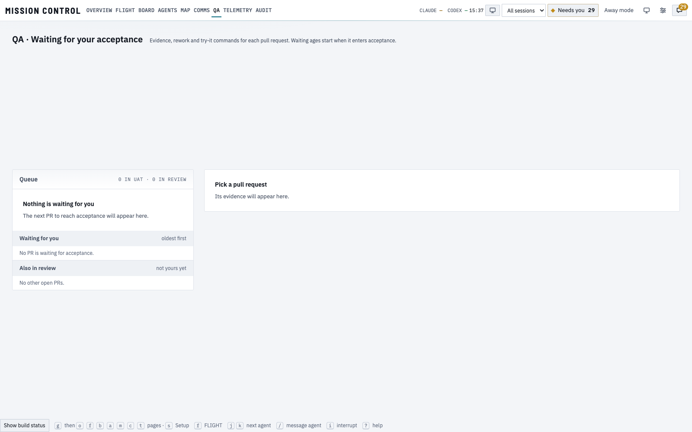
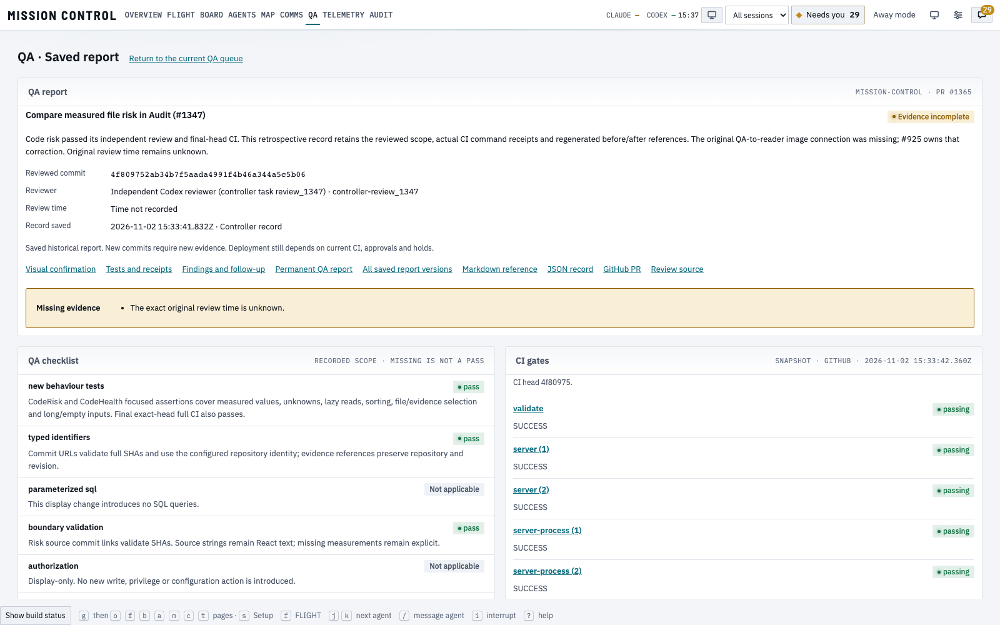
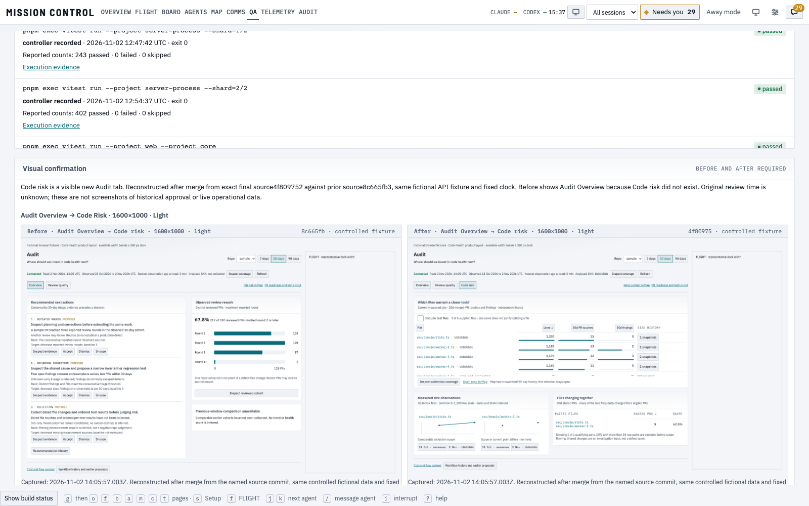

# Accountable QA report reader

A merged controller PR previously disappeared from the QA queue. Its GitHub image gallery did not create a complete QA record in the reader. The new reader opens an immutable report by reference after merge, with the exact reviewed commit, reviewer/source/time, CI snapshot, distinct test receipts and reported counts, checklist, findings, limitations, follow-up and retained before/after images.

These captures show the actual production web builds and HTTP API readers on isolated free ports. They use a copied database and the same fixed clock, not a live hub restart or crew run. The displayed historical record is PR #1365. Its missing original review time stays explicit; the new reader does not turn that gap into an original historical approval.

| Source | Commit |
| --- | --- |
| Before reader | `8b0054c8c31585d6808535328939e65e41b65ce6` |
| After reader source photographed | `ee20737e0b41e319b2cb54232291b7e2330086e0` |
| PR #1365 source being reported | `4f809752ab34b7f5aada4991f4b46a344a5c5b06` |
| Capture time, UTC | 2026-11-02T15:37:10.935000+00:00 |

The implementation later adds this gallery as evidence only. The machine-readable [render checks](render-checks.json) retain the photographed source commit, capture clock, image authentication/hash result, viewport measurements and successful full-image action.

## Before and after

| Theme, 1600×1000 | Before | Report visible | Paired images visible |
| --- | --- | --- | --- |
| Light | [Old queue](qa-reader-1600x1000-light-before.png) | [Saved report](qa-reader-1600x1000-light-after.png) | [Visual confirmation](qa-reader-1600x1000-light-visual.png) |
| Dark | [Old queue](qa-reader-1600x1000-dark-before.png) | [Saved report](qa-reader-1600x1000-dark-after.png) | [Visual confirmation](qa-reader-1600x1000-dark-visual.png) |

## What was checked

- Twenty-four production captures cover 1280×900,1600×1000,1920×1080 and1600×700 in both themes: old reader, saved report and visual confirmation. There are zero browser page or console errors and no measured horizontal panel clipping.
- Actual retained screenshots load through the protected HTTP route:401 without the operator key,200 with it, `image/png`, private/no-store, SHA-256 matches. Thirty-two browser image responses succeed. No credential appears in the image URL.
- Displayed images use the existing allowed data-URL transport. Opening the full image uses a revocable blob URL: actual browser action returned an `image/png` document with1600-pixel natural width. The content policy is unchanged.
- Git-hosted PNGs are fetched read-only from the configured repository at an immutable commit, verified by Git blob identity and supplied SHA-256, then retained locally. The copied-database proof used the portable Git path without an existing native image manifest. All six PR #1365 images were retained.
- Review pruning cannot reuse an archived report identity. A regression deletes the old native review, creates a new one and keeps both PR snapshots separate.
- Automated reader checks cover wrong-head exclusion, merged reports, missing sections, failed CI, fifty long commands, unsafe links and long-label image-error recovery. Shared Board/Agent PR chips retain their compact preview controls and a24-pixel QA link.

## Limits and provenance

This is a new feature verification on a copied database. It is not an original sign-off for the older PR. The images inside PR #1365’s report are separately labelled controlled fictional references, reconstructed after its merge from the named Code risk source and baseline. Their underlying reference is [retained separately](../qa-reports/1365/README.md).

These pictures show QA evidence and recorded scope. Current deployment authority still depends on CI, independent review, approvals and holds. The pipeline parent #925 remains open for its other observation outcomes.
