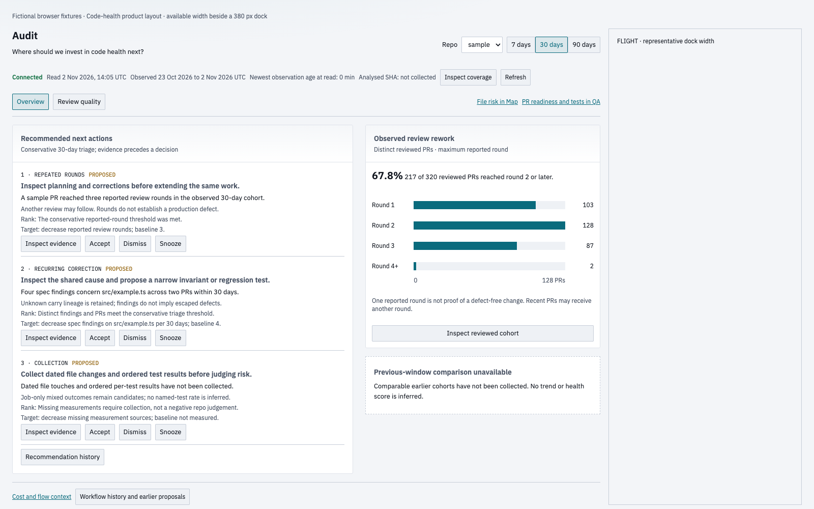
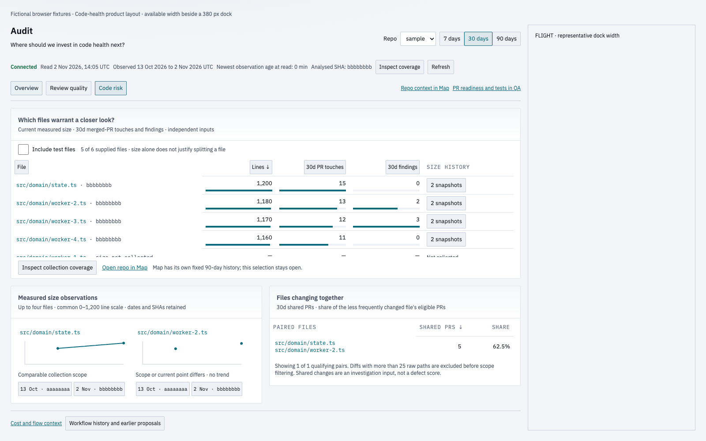

# QA reference: Code risk, PR #1365

The Code risk change passed its independent review and final-head CI. Its original gallery was linked in GitHub, but the QA reader did not show it. This reference records that gap and retains paired images for the report integration in #925.

This record is assembled on 2 November 2026, after merge. It does not invent a native RETRO review or backdate an approval. The original independent review's exact timestamp is not retained here.

| Reference | Value |
| --- | --- |
| PR | [#1365](https://github.com/Luke-Bradford/mission-control/pull/1365) |
| Reviewed final source | `4f809752ab34b7f5aada4991f4b46a344a5c5b06` |
| Prior source for these images | `8c665fb3de38cac8b9d588be10689b0b1113ebbc` |
| Merged commit | `5dffb6452936aa9fcd0829da513b2bcbaa6b4105` |
| Reviewer | Independent Codex agent, controller task `review_1347`; no formal GitHub review row was posted |
| Final CI | [CI run 41447227063](https://github.com/Luke-Bradford/mission-control/actions/runs/41447227063), all seven jobs passing |
| New image capture | 2 November 2026, 14:05:57 UTC; full details in [capture-checks.json](capture-checks.json) |
| Data | Controlled fictional fixture, same API answers and fixed clock for both sources |

## Visual confirmation

The before view is the prior Audit Overview: Code risk did not exist at that source commit. The after view opens Code risk. Both are actual production components built from the named source commits. These are reconstructed layout references captured after merge, rather than screenshots of a historical QA session or live operational data.

| Theme, viewport | Before | After | Difference |
| --- | --- | --- | --- |
| Light, 1600×1000 | [Prior Audit](audit-light-before.png) | [Code risk](audit-light-after.png) | [Pixel diff](audit-light-diff.png) |
| Dark, 1600×1000 | [Prior Audit](audit-dark-before.png) | [Code risk](audit-dark-after.png) | [Pixel diff](audit-dark-diff.png) |

Sixteen regenerated captures cover 1280×900, 1600×1000, 1920×1080 and 1600×700, in both themes, on both sources. They report zero browser page errors. At 1600×1000, the after view ends at 976 pixels beside the representative FLIGHT dock.

## Coverage and checks

- Final-head CI passed validate, server (1), server (2), server-process (1), server-process (2), web-core and the aggregate check.
- The retained final formatter/UI test log records 24 passing cases: formatContract, CodeRisk and CodeHealth. It ran at 12:44 UTC before the final push. The independent reviewer checked the formatter correction in the same review pass.
- Earlier, 25 focused cases passed on the preceding implementation: 7 CodeRisk, 16 CodeHealth and 2 browser cases. Those earlier browser results are supporting evidence, not a claim that those local commands ran again on the final commit.
- Browser coverage included required widths and themes, empty/50-file/long-path inputs, keyboard access, scrolling, lazy reads and retained evidence selection. The regenerated references above now use the exact final source.
- Lint, workspace types and production build passed in the retained controller records. Final CI supplies the durable GitHub receipts.

The final CI logs retain these actual command results ([receipt extract](ci-receipts.txt)):

| Command | Passed | Failed | Skipped | Files |
| --- | ---: | ---: | ---: | ---: |
| `pnpm exec vitest run --project server --shard=1/2` | 2701 | 0 | 10 | 84 |
| `pnpm exec vitest run --project server --shard=2/2` | 3548 | 0 | 16 | 84 |
| `pnpm exec vitest run --project server-process --shard=1/2` | 243 | 0 | 0 | 8 |
| `pnpm exec vitest run --project server-process --shard=2/2` | 402 | 0 | 0 | 8 |
| `pnpm exec vitest run --project web --project core` | 5242 | 0 | 0 | 237 |

The same CI run completed `pnpm -s lint`, `pnpm -s typecheck` and `pnpm -s build`. These broad regression results complement the specific Code risk and browser coverage above.

## What worked well

The tab keeps size, PR touches and findings separate. Unknown measurements remain explicit. Coupling has an eligible denominator and broad-PR exclusion note. Commit links and evidence stay tied to the selected repository. Comparable histories share a scale; incomparable observations do not become a growth claim.

## Findings and follow-up

No Critical or Important findings remained at merge. A Minor suggestion for visible historical-value rows was folded into the existing [rolling debt ticket #656](https://github.com/Luke-Bradford/mission-control/issues/656). Exact historical values remain in accessible chart text, titles and evidence.

The missing connection between GitHub images and the QA reader belongs to [#925](https://github.com/Luke-Bradford/mission-control/issues/925). It is not a reason to reopen delivered Code risk ticket #1347.

## Limits

This is a retrospective controller record, with the original review time unknown. The fixture does not prove every production dataset or grant deployment approval. The original PR has no native review row. Local log files are retained privately; GitHub CI links and the committed images provide the portable reference. New commits require new QA evidence.
