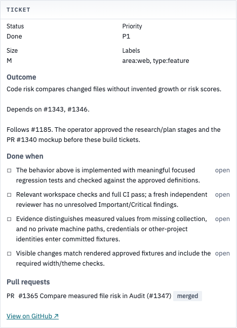
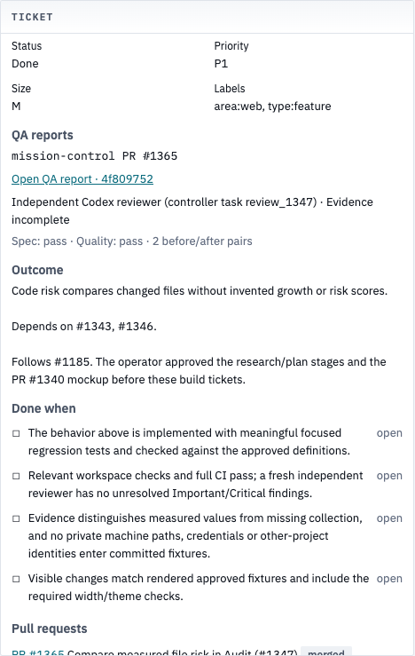
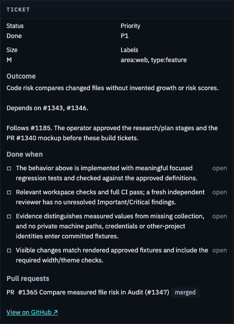
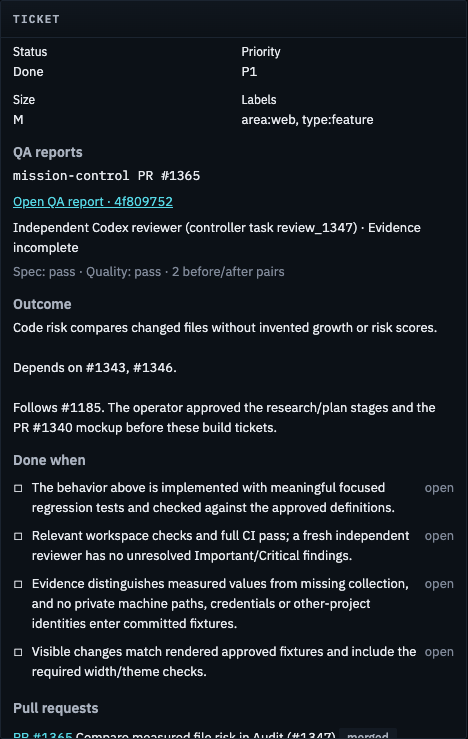
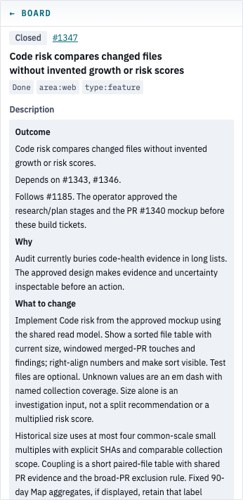
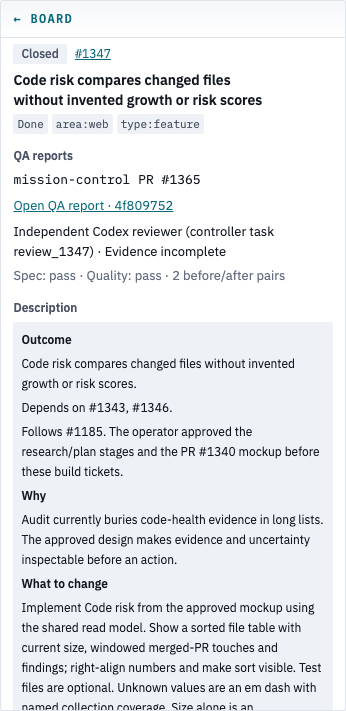
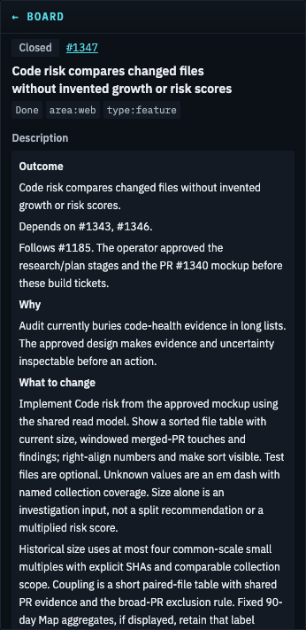
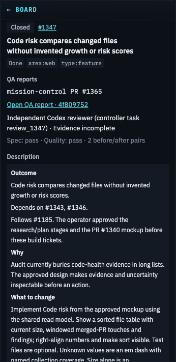

# QA reports reached from a closed ticket

The ticket form now links to retained QA reports for its associated PRs. Closed ticket #1347
provides the verification case: PR #1365 and its saved Code risk report already existed, but
both ticket views omitted their report links.

These are current verification captures, not historical approval screenshots. Production builds
at baseline `2b90233fa766a7ce4bfb82b03bb306cd6580c15f` and implementation
`02b1beb39dae59db16b0aab740c5d839034a98fa` use the same copied live database, fixed clock and
frozen public GitHub issue snapshot. The isolated apps run on free loopback ports without the
engine, supervisor, crew or observed-loop writes. Live GitHub calls are disabled during capture.

## Focused before and after

Scope: the **Ticket panel's visible region**, at the top scroll position in a **1600×1000
viewport**. These are region captures, not full-page images or proof of content outside that
region. The surrounding ticket heading and timeline were checked in separate viewport captures.

| Theme | Before | After |
| --- | --- | --- |
| Light |  |  |
| Dark |  |  |

## What was checked

- Both production sources at 1280×900, 1600×1000, 1920×1080 and 1600×700, light and dark:
  no horizontal page/panel clipping; the new report links meet the 24px target.
- Clicking the actual closed ticket's report link opens its immutable report. Both before/after
  PNGs decode in the reader. This HTTP proof starts on the ticket route; Board routing is unchanged.
- Focused integration and browser tests also cover live closing PRs before local collection,
  manually closed tickets, secondary closing-issue associations, configured cross-repository PRs,
  missing reports, unavailable report reads, earlier commits and unrelated report exclusion.
- The reader preserves PR #1365's missing original review time as incomplete evidence. The
  screenshots and a passing implementation review do not turn that historical gap into a pass.

[Render receipts](render-checks.json) record all 17 viewport captures, the decoded image dimensions,
source commits and browser errors (zero). The full viewport files remain in the private controller
proof directory; the four focused regions above are retained here. Remote CI and the final
independent review are recorded on the PR, separately from these browser receipts.

## Board-side ticket detail

The second renderer is also checked through its production `/board/mission-control/1347` route.
These paired captures show the **Board ticket panel's visible region**, top scroll position,
**1280×900 viewport**. They photograph source `80593768fd287d5fb74b2df33297550250bcb79b`,
which differs from implementation `02b1beb3` only in the evidence files above.

| Theme | Before | After |
| --- | --- | --- |
| Light |  |  |
| Dark |  |  |

[Board render receipts](board-render-checks.json) cover 1280×900 and 1600×700, both themes and
both sources, with correct report links, 24px targets, no horizontal clipping and zero page errors.
The image crops intentionally exclude the surrounding board's unrelated operational data.
