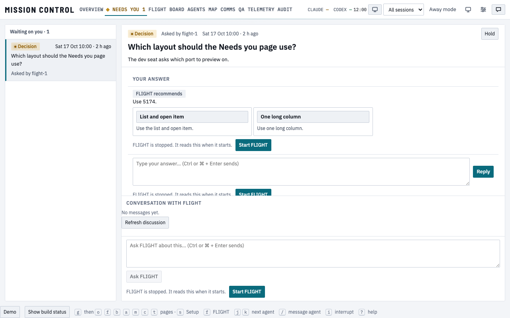
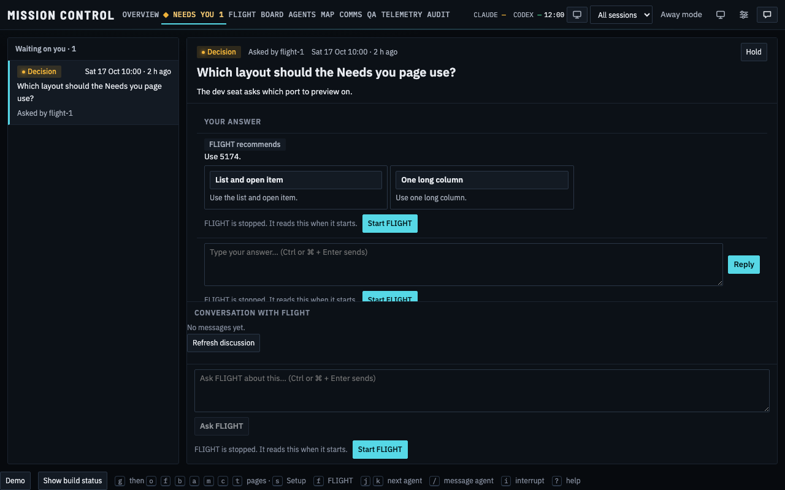
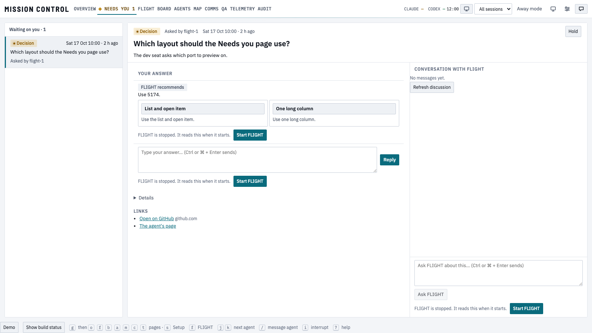
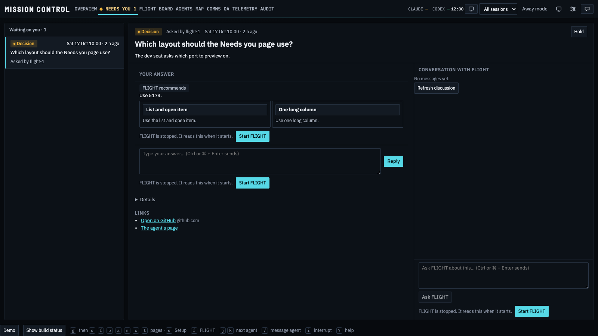

The ticket-required stopped-state images are retained on this PR head. They were captured from b1dc1970 with the same web tree as this documentation-only addition. The manifest records source, fixture, clock, browser, viewport, theme, time and image hashes.

These public fixture images show the new stopped state. The independent review must retain them in its visual evidence. Earlier matched baseline pairs remain on the dedicated evidence branch; no live data is published.

The follow-up cleanup removes the unused `ASK_PREFIX` constant in the answer helper. Both actual production builds contain the same 81 files with identical SHA-256 hashes. `unused-constant-asset-proof.json` retains that comparison and the changed source-file hash. The screenshots still represent the original captured source named above; no new capture is claimed.
