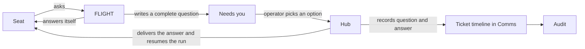

# Comms, Needs you and the FLIGHT fly-out: one message system, four clear places

**Status:** design, 6 November 2026. Waiting for the operator's approval. Nothing here is built yet.
Where a line is marked **(operator)**, the operator said it. Where it is marked **(controller's
call)**, the controller chose it and the operator can change it.

## Intent

The message system is how the crew works. Seats ask FLIGHT (the head agent), hand work over and
report through it. It is also the only way a question reaches the operator.

The operator tried to use it on 5 November 2026 and it "didn't sit right at all" **(operator)**:

- The FLIGHT chat box took no text.
- Needs you was spread over narrow panes with too little context.
- Questions made no sense without knowing the project.
- Comms showed machine messages that looked like they were for the operator.

The operator wants **(operator)**:

- One place for questions. Each question is complete by itself, with background, possible
  solutions and pictures where they help. The operator picks an option or asks more.
- Mockups and flow diagrams shown with a question, and the question tracked against a ticket.
- A quick way to ask FLIGHT about something seen on any page.
- Comms as the record: who messaged the team, what was said about a ticket, and a way to reply
  to one message.
- Audit and logs tagged to a ticket or PR, so problems can be traced.
- A Needs you list that can be filtered and ordered by priority or date when a backlog builds.

## What was found on 6 November 2026

Measured on the live hub at commit `47c1f5bd`.

| Finding | Evidence |
|---|---|
| Comms carries the crew | 210 messages in 24 hours: 81 between FLIGHT and seats, 44 seat to seat, 34 hub to seat, 51 to or from the operator's name |
| The operator's name is on machine messages | 23 of 26 messages sent as `CAPCOM` came from the controller session. 22 of 25 sent to `CAPCOM` start "For the controller:" |
| Needs you is mostly not questions | 10 items, 1 real decision. The rest: 3 stale items from paused loops, 3 "PR · You: review" rows, 2 FLIGHT stall notices, 1 controller reminder |
| The one real question did not stand alone | Its headline held four raw `127.0.0.1` addresses. Its options assumed the reader knew #1434 and PR 1423 |
| Picking an option sends chat text | `apps/web/src/shell/ItemDetail.tsx:192`. Nothing ties the click to the question |
| An answer to a seat is stored, not delivered | `apps/server/src/comms.ts:117`. The seat reads it at its next turn |
| A question's text is not on its ticket | The seat's question is in `seat_questions`. Comms holds a pointer line only |
| A brief cannot carry a picture | `AttentionBrief` in `packages/core/src/types.ts` has no picture, link or ticket field |
| Three ways to type to FLIGHT | The dock posts a seat message. Comms posts a stored message. A Needs-you item posts to its own discussion |
| The fly-out is missing on three pages | `apps/web/src/App.tsx:154` leaves the dock off Comms, FLIGHT and Needs you |
| A dead chat box can look live | `apps/web/src/shell/Dock.tsx:151`. Until FLIGHT's state loads, the box is off but shows its normal hint |
| Hub messages are log noise | The Comms copy of a CI failure is the first 1,200 characters of the raw log |
| The hub's conversation list is broken | `/api/comms/agents/<seat>/contacts/MC` answers 404. The page shows "No messages yet" |

## Goals

1. Each place has one job, and the operator can say which place to use for what.
2. A question for the operator stands alone, offers choices and can carry pictures.
3. A choice does what it says, reaches the run that asked, and is recorded on the ticket.
4. Every message says who sent it: the operator, the controller, FLIGHT, a seat or the hub.
5. Everything said about a ticket or PR can be read in one timeline.
6. No text box looks live when it is not.

## Non-goals

- A redesign of the Audit page or the Comms graph.
- The cross-machine rooms and relay from the 24 October agent-comms spec. See "Rooms" below.
- Phone layouts.
- Merging every store into one table. The rules below matter; the storage is the builder's.
- Picture upload by the operator. FLIGHT can open the same page the operator is on.

## Anti-goals: it fails even if it works when

- a question needs project knowledge the reader was not given;
- a question for the operator appears anywhere other than Needs you;
- an option click only sends chat text;
- a machine's message carries the operator's name;
- the Needs you count includes things that are not questions.

## The four places

| Place | The question it answers | What the operator does there |
|---|---|---|
| **Needs you** (page) | What needs my decision? | Reads a complete question, picks an option, asks more, holds it |
| **FLIGHT fly-out** (every page) | Can I ask FLIGHT about this now? | Types a short question about what is on screen |
| **Comms** (page) | Who said what, to whom, about which ticket? | Reads the record, replies to one message |
| **Audit** (page) | What went wrong, or might? | Reads problems, each linked to its ticket or PR |

Nothing else shows questions for the operator. Overview, Board and Agent pages show a count or a
chip that opens Needs you.

## How a question travels

The rule from the 28 October roadmap stays: only FLIGHT asks the operator, and seats ask FLIGHT.

## Rules the hub keeps

These live in hub code, not in prompts, so they hold for any model.

### 1. Senders are named for what they are

Every message records a sender kind: `operator`, `controller`, `flight`, `seat` or `hub`.

- The hub sets it from how the request was made, never from the text.
- `operator` means a person typed it in the HUD.
- The controller session gets its own credential and its own name. It stops posting as `CAPCOM`.
- FLIGHT's actions through its operator tool are recorded as FLIGHT's.
- The engine's messages are recorded as the hub's. Today's `MC` sender becomes kind `hub`.

### 2. Every message carries its ticket

- The hub fills the ticket from the sender's run when the sender gives none.
- One format is stored: `repo#n`. A PR number stays in `ref`.
- A seat's question to FLIGHT is stored with its full text against the ticket. The pointer line
  ("Question recorded for FLIGHT") goes.

### 3. Needs you holds questions, and nothing else

An item is in Needs you only when it carries a complete question for the operator (rule 4).
Everything that reaches the operator today for another reason moves:

| Today in Needs you | Where it goes |
|---|---|
| FLIGHT stopped, late or tripped; hub Update needed; account at its stop line | **Alerts**: a header chip, shown on every page when not empty, opening a short list with one action each **(controller's call)** |
| "For the controller" asks | The FLIGHT and controller conversation in Comms, plus a count on FLIGHT's status line. An ask older than a set limit becomes an alert **(controller's call)** |
| Stale PR rows with no question | FLIGHT's own queue. FLIGHT moves the PR or writes a real question |
| Questions from observed loops | FLIGHT's queue until FLIGHT writes a complete question. FLIGHT holds them while a loop is paused |

The Needs you count is the number of open questions. Alerts are counted on their own chip.

### 4. A question is complete or the hub refuses it

Tickets #759, #1389 and #1390 already define most of this: the question, why it is the
operator's, context, who FLIGHT asked, two to four options with consequence and whether each can
be undone, a recommendation, and what happens with no answer. This design keeps that contract and
adds:

- **A title**: one line, at most 90 characters, no web address, no bare ticket number.
- **A priority**: P0 to P3, taken from the ticket unless FLIGHT gives another with a reason.
- **A ticket**, or the repo and a stated reason for having none.
- **Attachments** (rule 5). A question about how something looks must carry a picture or preview.
- **No raw addresses in the title or the decision sentence.** Links go in the links list.

The hub also shows every `#n` and `PR n` with its title beside it, so a number never stands alone.

The hub cannot judge whether the background is good enough. Two things cover that:

- The `plain-talk` skill tells FLIGHT how to write it for a reader new to the project.
- Audit counts questions where the operator's first reply was itself a question (rule 9).

### 5. A question can carry pictures and previews

A brief gains a list of attachments, each with a caption **(controller's call)**:

- **Picture**: an image the hub already stores. FLIGHT's page screenshots, PR evidence and QA
  shots qualify today. A seat or FLIGHT can also store an image file through the hub.
- **Preview**: a branch build opened at full width (#1454, #1458). A static mockup page or a flow
  diagram page is a preview too.
- **Link**: a safe link, by the rules PR 1465 added.

A flow diagram is a picture or a preview page in this version. Drawing a diagram from text in the
HUD is left for later.

### 6. A choice is bound, delivered and recorded

- Picking an option calls the hub with the question id and the option id (#1389).
- The hub delivers the answer to the run that asked, even if that seat has moved on (#1474).
- Delivery wakes a waiting run. It does not wait for a turn that might not come.
- The hub closes the question and records the question, the choice and the time on the ticket.
- The page shows a receipt: what was chosen, where it went, and whether the seat has read it.

"Something else" lets the operator write their own answer. It follows the same path.

### 7. A reply from the operator is delivered

A reply to an agent's message in Comms wakes a waiting seat, or lands at the next turn of a
working one. The message shows its state: stored, read by the seat, or acted on. The hub already
records when a seat reads its inbox.

If the run that wrote the message has ended, the page says so before sending. The reply then goes
to the seat now on that ticket, or to FLIGHT when there is none.

### 8. Hub messages are notices

- Kind `notice`, sender `hub`. One plain line: "CI failed on 341f108: 2 tests in web-core."
- The text names the failing job and test, then the first error lines, with a link to the run.
- Notices do not count as unread and can be hidden with one switch.

### 9. Audit reads the same records

Each of these is a row in Audit, linked to the ticket's timeline in Comms:

- a question where the operator had to ask what it meant;
- a question that waited longer than a set time;
- a reply or answer that arrived after its run ended;
- two agents past six rounds on one ticket (exists today);
- the same message sent more than once;
- the same hub notice repeated on one PR;
- an ask for the controller that waited longer than a set time.

## Needs you page

Builds on the page PR 1465 added: a list on the left, the open question on the right.

**The list**

- Shows open questions only. Held and answered questions are one filter away.
- **Filters (operator):** repo, priority, who asked, state. A search box for the text.
- **Order (operator):** by priority then oldest by default. Also oldest first, newest first, and
  soonest deadline.
- Work that is waiting on an answer sorts first within its priority **(controller's call)**.
- Each row: title, ticket, priority, age, and "2 seats waiting" when that is true.

**The open question, in reading order**

1. Title, ticket, priority, who asked, age.
2. The decision in one sentence.
3. Background: what this is, what changed, why it needs the operator now.
4. Pictures and previews, shown at reading width. A click opens one at full size.
5. Options as cards: what happens, what it costs, whether it can be undone. The recommended one is
   marked, with the reason.
6. Actions: pick an option, **Something else**, **Ask a question**, **Hold**.
7. Detail, one click away: what FLIGHT checked, who it asked, links.

The conversation stays in its own column beside the question, as today. Its box fills the column
(#1478).

**Start a topic (controller's call).** The operator can open a topic from this page: a title, some
text and an optional ticket. FLIGHT replies in the conversation and can add pictures and options.
It is the same record with the direction reversed, and it shows under "Started by you". A fly-out
exchange that grows can be moved here.

**An example of a complete question.** The 5 November design approval, rewritten as an
illustration:

> **Approve two page designs before they are built**
> #1417 Dependencies view · #1434 Agents page · P0 · FLIGHT · 31 hours
>
> **Decide:** may the crew build these two designs as shown?
>
> **Background.** Two mockups are ready. Neither changes the live app until built.
> *Dependencies* adds a chip to Board cards showing what a ticket waits on and what it unblocks.
> *Agents page* shows what one seat is doing on a single screen. It removes two token counts,
> "Tokens this run" and "tokens so far", because they leave out cached reads and mislead.
>
> *[picture: Board card with the new chip] [picture: Agents page, seat running] [Open preview]*
>
> **Options**
> 1. **Approve both (recommended).** Agents is built first. Four Dependencies tickets are filed at
>    P2. Can be undone: yes, nothing ships until each build is reviewed.
> 2. **Approve Agents only.** Dependencies waits for your changes.
> 3. **Approve Dependencies only.** Agents waits for your changes.
> 4. **Change both first.** Nothing is filed or built.
>
> **Why FLIGHT recommends 1.** The Agents ticket is P0. Removing the two counts is the only loss,
> and Context and Cost stay.

## FLIGHT fly-out

**Job:** a quick check-in from any page **(operator)**. FLIGHT has full access, so the operator
asks it instead of looking things up.

- Opens on every page with the same key (`f`) and header button, Comms, FLIGHT and Needs you
  included.
- Holds the conversation only, at full height. The waiting list goes. One line says "3 questions
  wait" and opens Needs you.
- **Knows where the operator is (controller's call).** A chip above the box names the page and the
  selected ticket or seat. It is sent with the message and can be removed. FLIGHT can open the
  same page itself.
- **The box always takes text.** The message is stored at once. Under it, a state line says: sent,
  read by FLIGHT, or "FLIGHT is stopped. Start FLIGHT", with the button. A stored message is
  delivered when FLIGHT starts.
- **One conversation.** The fly-out and Comms show the same thread between the operator and FLIGHT.
  FLIGHT's replies to the operator are recorded in that thread, not only in its session stream.
- A multi-line box. One send rule for every box in the app: Enter sends, Shift and Enter adds a
  line **(controller's call)**.
- Width and whether it can be pinned beside the page are settled in the mockup.

## Comms

**Job:** the record **(operator)**. Decisions are not made here.

- **Left column:** Team, FLIGHT and you, FLIGHT and the controller, Agents, Tickets.
- The Decisions panel goes. Needs you has its own page.
- **Tickets** is a list with search. A ticket opens one timeline: messages, questions and their
  answers, FLIGHT's decisions, hub notices, handovers, reviews and CI. The ticket route already
  merges most of these; questions, briefs, discussions and holds are added.
- Clicking a ticket number opens the ticket. Filtering the chat by a ticket is a separate control
  **(operator, 5 November)**.
- **Reply** on any message (exists today) now delivers and shows its state (rule 7).
- Every message shows its sender kind as a tag: YOU, CONTROLLER, FLIGHT, a seat's call sign, HUB.
- Unread counts cover only what is addressed to the operator. Other figures are labelled as
  message counts.
- The hub's conversation opens (the 404 is fixed).

## Rooms (not in this design)

The 24 October spec describes rooms shared across machines through a relay. That code exists in
`packages/agentcomms` and `apps/relay`, and the hub does not use it yet. When it is wired in, a
room appears in Comms beside Team. A question that reaches the operator from a room follows
rules 3 to 6 like any other.

## Words

One name for one thing in everything the operator reads.

| Word | Meaning |
|---|---|
| Question | Something only the operator can decide. Lives in Needs you |
| Topic | A discussion the operator started. Lives in Needs you |
| Alert | Something broken that needs the operator's hand. Lives on the header chip |
| Message | Anything an agent or person sent. Lives in Comms |
| Notice | A message the hub wrote itself |
| Handover | What one run leaves for the next run on a ticket |
| Hub | Mission Control's own engine. Not an agent and not a person |
| Controller | A Claude Code session outside the crew, on this repo only |

## Order of work

Tickets are filed after approval. FLIGHT or the planner can split them.

**Already open, kept as they are**

| Ticket | Covers |
|---|---|
| #1389 | Hub checks a complete brief and binds each choice (in rework) |
| #1390 | The complete brief shown open, with bound Accept and Discuss |
| #1474 | An answer names its question, so it reaches the right run |
| #1478 | Conversation box width and Hold on the Needs you page |
| #1458 | A branch preview opens from a question (in progress) |
| #1464 | Remove the dead Asked-of-you file |

**New, in this order (controller's call)**

1. Senders named for what they are, with a tag on every message (rule 1).
2. Needs you holds only questions; Alerts chip; filters, order and priority (rule 3, the list).
3. Questions carry a title, ticket, pictures and previews. Follows #1389 (rules 4 and 5).
4. Answers and replies are delivered, with a state shown (rules 6 and 7).
5. The fly-out on every page, one FLIGHT conversation, a box that always takes text.
6. Comms: ticket timeline, sender tags, no Decisions panel, unread rule, hub conversation fix.
7. Hub notices in plain words (rule 8).
8. Start a topic.
9. Audit rows for comms problems (rule 9).

Items 2, 5 and 6 change what a page looks like. Each gets a mockup in the real app, on a branch,
checked at 1920x940 and 2560x1145, before its build ticket starts.

## How we know it worked

- The Needs you count equals the number of real questions, checked by hand for a week.
- No message is recorded as the operator's unless the operator typed it.
- The share of questions answered with no clarifying message rises.
- The time from an answer to the seat acting on it is measured and shown.
- A browser test covers each text box: it takes text, or it says why not.

## Security

- No new GitHub writes.
- The controller's credential grants nothing new. It only labels what the controller already does.
  An agent with shell access on this Mac could still read the operator's token, as today. Sender
  kinds make honest traffic clear; they are not a defence against that.
- A choice acts only through the bound, authorised path #1389 defines. Chat text never runs one.
- Pictures are shown only from hub storage. Links follow the safe-link rules. A preview runs on its
  own origin (#1458).
- A stored message for a stopped FLIGHT is delivered only to FLIGHT, on its next start.

## Left to the builder

- The storage shape, so long as the rules hold.
- How the hub tells a controller request from an operator request.
- The limits behind "a set time" in rules 3 and 9, as config with stated defaults.
- The fly-out's width and pinning, settled by its mockup.
- How a seat stores an image file through the hub, and its size limit.
