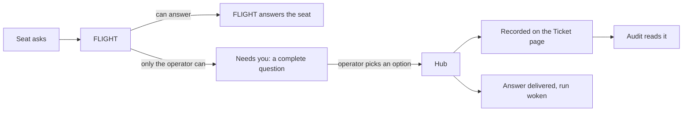

# Comms, Needs you and the FLIGHT fly-out: one message system, four clear places

**Status:** design, 6 November 2026. It waits for the operator's approval. Nothing here is built.
A line marked **(operator)** is something the operator said. A line marked **(controller's call)**
is the controller's choice, and the operator can change it.

## Intent

The message system is how the crew works. It is also the only way a question reaches the operator.

The operator used it on 5 November 2026 and it "didn't sit right at all" **(operator)**:

- The FLIGHT chat box took no text.
- Needs you was spread over narrow panes with too little context.
- Questions made no sense without knowing the project.
- Comms showed machine messages that looked like they were for the operator.

The operator wants **(operator)**:

- One place for questions. Each question is complete by itself: background, possible solutions,
  and pictures where they help. The operator picks an option or asks more.
- Mockups and flow diagrams shown with a question. The question is tracked against a ticket.
- A short way to ask FLIGHT about something seen on any page.
- Comms as the record: who messaged the team and what was said about a ticket.
- A way to reply to one message from an agent.
- Audit and logs tied to a ticket or PR, so a problem can be traced.
- A Needs you list that can be filtered, and ordered by priority or date.

## Words

One name for one thing, in this document and in the app.

| Word | Meaning |
|---|---|
| Operator | The person running Mission Control. Called CAPCOM in the app |
| FLIGHT | The head agent. It runs the crew and is the only agent that asks the operator |
| Seat | One crew agent, such as a developer or a reviewer |
| Run | One seat's work on one ticket, from start to end |
| Hub | Mission Control's own server. It is not an agent and not a person |
| Controller | A Claude Code session outside the crew that helps on this repo. Other repos have none |
| Question | Something only the operator can decide. In code it is a brief on a Needs-you item |
| Alert | The hub or FLIGHT cannot work until the operator acts |
| Message | Anything a person or agent sent |
| Notice | A message the hub wrote itself |
| Handoff | What one run leaves for the next run on a ticket |
| Hold | The operator sets a question aside until a date or event |
| Fly-out | The FLIGHT chat panel that opens over a page. The code calls it the dock |

## What the controller found on 6 November 2026

The controller read the live hub at commit `47c1f5bd`.

| Finding | Evidence |
|---|---|
| Comms carries the crew | 210 messages in 24 hours: 81 between FLIGHT and seats, 44 seat to seat, 34 hub to seat, 51 to or from the operator's name |
| The operator's name is on machine messages | 23 of 26 messages sent as `CAPCOM` came from the controller. 22 of 25 sent to `CAPCOM` start "For the controller:" |
| Needs you is mostly not questions | 10 items, 1 real decision. The rest: 3 old items from stopped loops, 3 "PR · You: review" rows, 2 notices that FLIGHT was late, 1 reminder for the controller |
| The one real question did not stand alone | Its headline held four raw `127.0.0.1` addresses. Its options assumed the reader knew two ticket numbers |
| Picking an option names no option | `apps/web/src/shell/ItemDetail.tsx:192`. To a seat it sends chat text. To FLIGHT it posts in the item's discussion |
| An answer to a seat is stored, not delivered | `apps/server/src/comms.ts:118`. The seat reads it at its next turn. The route can deliver to the asking run, but the page never names the question |
| A seat's question is not on its ticket | The text is in `seat_questions`, which has no ticket. Comms holds a pointer line only |
| A question can show only pictures the hub already holds | `apps/web/src/needs/pictures.ts`. A new mockup image has nowhere to be stored |
| At least three ways to type to FLIGHT | The fly-out posts a seat message. Comms posts a stored message. A Needs-you item posts to its own discussion |
| The fly-out is left off three pages | `apps/web/src/App.tsx:155`. Comms, FLIGHT and Needs you have none. This was a decision; see "What this changes" |
| A dead chat box can look live | `apps/web/src/shell/Dock.tsx:151`. Until FLIGHT's state loads, the box is off but shows its usual hint |
| Hub messages read as log noise | The Comms copy of a CI failure is the first 1,200 characters of the log excerpt |
| The hub's conversation does not open | `/api/comms/agents/<seat>/contacts/MC` answers 404 (`apps/server/src/api.ts:2013`) |

## Goals

1. Each place has one job. The operator can say which place to use for what.
2. A question for the operator stands alone, offers choices and can show pictures.
3. A choice sends its bound answer to the run that asked, and the ticket's history records it.
4. Every message says who sent it: the operator, the controller, FLIGHT, a seat or the hub.
5. Everything said about a ticket or PR can be read on one page.
6. No text box looks live when it is not.
7. Keeping the record costs the agents no extra tokens.
8. The record outlives any one session.

## Non-goals

- A redesign of the Audit page or the Comms graph.
- The cross-machine rooms from the agent-comms spec. See "Rooms".
- Phone layouts.
- One new table for everything. The rules matter; the storage is the developer's choice.
- Picture upload by the operator. FLIGHT can open the page the operator is on.
- A change to the activity log. Its rows already link to tickets.

## Anti-goals: it fails even if it works when

- a question needs project knowledge the reader was not given;
- a question for the operator can be answered in a second place;
- an option click only sends chat text;
- a machine's message carries the operator's name;
- the Needs you count includes something that does not wait on the operator.

## The four places

| Place | The question it answers | What the operator does there |
|---|---|---|
| **Needs you** (page) | What needs my decision? | Reads a complete question, picks an option, asks more, sets it aside |
| **FLIGHT fly-out** (every page) | Can I ask FLIGHT about this now? | Types a short question about what is on screen |
| **Comms** (page) | Who said what, and to whom? | Reads the record, replies to one message |
| **Audit** (page) | What went wrong, or might? | Reads problems, each linked to its ticket or PR |

A question is answered on the Needs you page only. Other pages show a count or a chip that opens it.

## How a question travels

Seats ask FLIGHT, and FLIGHT asks the operator. That rule from #758 (seats ask FLIGHT) stays. The
hub can also write a question itself, such as a queue change to approve. It meets the same rules.

## Rules the hub keeps

These live in hub code, not in prompts, so they hold for any model.

### 1. Senders are named for what they are

Every message records a sender kind: `operator`, `controller`, `flight`, `seat` or `hub`.

- The hub sets the kind from how the request was made, never from the text.
- `operator` means a person typed it in the app.
- The controller gets its own credential and its own name. It stops posting as `CAPCOM`.
- The controller keeps what it can do today: read, reply, pin, and mark a message done.
- A controller message wakes FLIGHT as an operator message does today.
- FLIGHT's actions through its operator tool are recorded as FLIGHT's.
- The hub's own messages get kind `hub`. Today they are sent as `MC`.
- Messages stored before this change keep their old sender.
- Rooms will add a sixth kind, for an agent on another hub.

Today FLIGHT treats any line without the hub's prefix as the operator's
(`packages/core/src/flight.ts:24`). With this rule, FLIGHT is told which lines are the
controller's. That file and FLIGHT's role file are hard-rule files, so the change needs clearance.

### 2. A message about a piece of work carries its ticket

- The hub fills the ticket from the sender's run when the sender gives none.
- A fly-out line carries the ticket the operator has open, when there is one.
- New messages store one format: `repo#n`. Older rows stay as they are.
- A seat's question to FLIGHT is stored with its full text and its ticket. The pointer line goes.

### 3. Needs you counts only what waits on the operator

An item waits on the operator only when it carries a complete question (rule 4). The table under
"Where today's items go" places every other kind.

The Needs you count is the number of open questions. Alerts have their own chip.

When a hub has no FLIGHT seat at all, a seat's question goes to the operator as today. The page
marks it "asked by a seat, not checked by FLIGHT".

### 4. A question is complete or the hub refuses it

#759 (complete operator briefs) and its server ticket #1389 already set the contract. A question
has: the question itself, why it is the operator's, context, who FLIGHT asked, two to four
options, a recommendation, what happens with no answer, the cost of delay, and how fresh it is.
Each option says what follows and whether it can be undone.

This design keeps that contract and adds **(controller's call)**:

- **One decision per question.** Two decisions are two questions.
- **A title:** one line, at most 90 characters, no web address, no bare ticket number.
- **A priority,** using the board's Priority values. It comes from the main ticket. FLIGHT states
  one when the ticket has none.
- **One main ticket,** and any related tickets. With no ticket, FLIGHT names the repo and says why.
- **A picture or preview** on any question about how something looks (rule 5).
- **No raw addresses** in the title or the question sentence. Links go in the links list.

The hub shows every `#n` and `PR n` with its title beside it, so a number never stands alone.

The hub cannot judge whether the background is good enough. Two things cover that:

- The `plain-talk` skill tells FLIGHT how to write for a reader new to the project.
- Audit counts questions where the operator's first reply was itself a question (rule 9).

### 5. A question can show pictures and previews

Most of this exists since PR 1465 (the Needs you page). A picture is written in the question's
text, and the page shows it large when the hub holds the image. This design adds two things:

- **A store for a new image.** A seat or FLIGHT can give the hub an image file, such as a mockup or
  a flow diagram. The hub returns an address that works in a question.
- **The check in rule 4.** The hub reads the text for a picture, or finds a preview for the ticket.

A preview is a branch's build opened at full width, from #1454 and #1458 (branch previews). A
mockup is a branch preview, so it uses the real app's styles. The question's form does not change.

### 6. A choice is bound, delivered and recorded

- Picking an option calls the hub with the ids #1389 defines. Chat text never picks an option.
- **A seat asked:** the hub delivers the answer to that run and wakes it. #1474 (answers name
  their question) covers the page's part. FLIGHT is told.
- **FLIGHT asked for itself:** the answer goes to FLIGHT and wakes it.
- **The asking run has ended:** the answer goes to FLIGHT, which passes it to the ticket's next
  run. The hub never hands an answer straight to a different run.
- The hub closes the question and adds the question, the choice and the time to the ticket's
  history. Nothing is written to GitHub.
- The page shows a receipt: what was chosen, where it went and when it was delivered.

The operator can also write to FLIGHT in the question's conversation, to ask more or to propose
something else. That text never picks an option and never approves anything. FLIGHT answers, or
writes the question again with new options.

### 7. A message from the operator to a seat is delivered

A message or reply from the operator wakes a waiting seat. A working seat gets it at its next turn. The
message shows its state: stored, or delivered with the time.

If the run that wrote the message has ended, the page says so before sending. The reply then goes
to the seat now on that ticket, or to FLIGHT when there is none. This applies to replies only,
never to an answer (rule 6).

### 8. Hub messages are notices

- Kind `notice`, sender `hub`.
- The Comms copy is one plain line with a link: "CI failed on 341f108 in job web-core."
- The seat still gets the full log excerpt. The same ticket checks that it shows the failing test.
- Notices do not count as unread. One switch hides them.

### 9. Audit reads the same records

Each of these becomes a row in Audit's list of things to improve, linked to its ticket:

- a question where the operator had to ask what it meant;
- a question that waited longer than a set time;
- a reply or answer delivered after its run ended;
- two agents past six rounds on one ticket (the hub counts this today);
- the same message sent more than once;
- the same notice repeated on one PR;
- a request for the controller that waited longer than a set time;
- a ticket whose messages cost far more tokens than usual.

## Where today's items go

| Today in Needs you | Where it goes |
|---|---|
| A question FLIGHT or the hub wrote, complete by rule 4 | Stays |
| A person waiting on GitHub, with FLIGHT's suggested replies | Stays. The replies are the options |
| "FLIGHT will do this unless you object", with its 40-minute clock | Stays on the page in its own group. Not counted, because no answer is needed |
| A held question | Stays on the page in the Held group. Not counted |
| FLIGHT stopped or late | **Alert.** The alert lists what waits behind FLIGHT, and each raw item opens from it, as today |
| The hub needs an Update only the operator can run; an account has hit its limit | **Alert** |
| FLIGHT's safety stop tripped | Stays, as a question with bound choices, as #1389 defines |
| A request "for the controller" | Comms, addressed to the controller. If none answers in a set time, FLIGHT writes it as a question |
| A seat that stalled or failed, a stray process, a blocked test lock, a PR nobody is moving | FLIGHT's queue, shown on the FLIGHT page. FLIGHT fixes it or writes a question |
| A question from a loop Mission Control only watches | FLIGHT's queue until FLIGHT writes a complete question |
| FLIGHT's own lines that mention the operator | The FLIGHT conversation, marked unread |

**Alerts (controller's call).** A header chip on every page, shown only when there is an alert. It
opens a short list. Each alert has one link to the place that fixes it, such as Start FLIGHT. An
alert clears when its cause clears. Alerts send a browser notice, as "FLIGHT is down" does today.

## What it costs the agents

The record must not become a place where agents spend tokens **(operator, 6 November)**.

**1. Agents write nothing extra.** The hub records the sender, ticket, delivery, question and
answer itself, from the tools agents already call. There is no new tool and no duty to log.

**2. The hub pushes; agents do not scan.** An agent gets only what is addressed to it, once, at
its next turn. That exists today, capped at 40 messages and 8,000 characters.

**3. A run gets its ticket's decisions at the start.** The handoff already gives a new run the
goal, what is done, what is left and the last six messages on the ticket. It gains the ticket's
answered questions: one line each with the choice, ten at most **(controller's call)**. A decision
is then not asked twice.

**4. A seat that needs more reads by ticket.** Today `comms_read` returns the newest 50 messages
across the whole crew, up to 20,000 characters, with no filter. It gains a ticket filter and
defaults to the seat's own ticket. The role files tell seats to read by ticket. Role files are
hard-rule files, so that change needs clearance.

Four smaller points follow from the rules above:

- The Comms copy of a notice is one line, so a later read does not pay for log text again.
- Hub code works out the Audit rows. No agent reads messages to find them.
- Delivering an answer to a seat does not wake FLIGHT. FLIGHT sees one line at its next wake.
- A refused question names the missing part, so FLIGHT fixes it in one try.

For scale, the crew sent 219 messages in the 24 hours to 6 November, about 83,000 characters.
The Comms graph already totals tokens per link. Audit uses that figure per ticket (rule 9).

## Kept outside any session

- The record lives in the hub's database, not in an agent's session. A new session or run gets
  what it needs from the hub.
- Today the hub deletes messages, FLIGHT's decisions, old briefs and answered seat questions
  after 90 days. It keeps runs, reviews and merged PRs for 365 days.
- Questions, their answers and the conversation on each are kept for 365 days, like runs
  **(controller's call)**. Messages stay at 90 days.
- Nothing new is written to GitHub. A copy of each decision on the GitHub ticket is left out.

## The simple path for a person

A person does two things here, and each has one way in.

- **Answer a question:** the Needs you tab. Its count shows on every page.
- **See what was discussed:** click a ticket or PR number, on any page. It opens the Ticket page,
  with the whole history in time order. An answered question links to the same page.

The Tickets list in Comms has a search box, for when the number is not known.

## How the pages get designed

Every page change goes through the `hud-design` skill and its dashboard reference,
`.claude/skills/hud-design/references/dashboard-layout.md` **(operator, 6 November)**. This
document sets what each place is for, what it holds and the reading order. It does not set a
layout. For each page that changes, the seat:

- names the page's question and reader, lists each panel's fields, and ranks the panels;
- sizes each panel from its content, at the viewports the reference lists;
- renders it busy, in the real app on a branch, and shows the operator before the build starts;
- lists anything dropped or moved.

**Dropped or moved by this design.** The operator agrees to these by approving it.

| Today | Change |
|---|---|
| Comms: the Decisions panel | Removed. Questions are on Needs you |
| Fly-out: the waiting list and summary | One line that opens Needs you |
| Needs you: alerts and FLIGHT's own items | The Alerts chip, and the FLIGHT page |
| Comms: unread counts per agent | Labelled as message counts |

## Needs you page

Starts from the page PR 1465 added. This section sets what the page holds and in what order.
The layout is settled through the `hud-design` skill (see "How the pages get designed").

**The list**

- Keeps its three groups: Waiting on you, FLIGHT will do unless you object, Held.
- **Filters (operator):** repo, priority, who asked. A search box for the text. Answered questions
  are one filter away.
- **Order (operator):** priority then oldest, by default. Also oldest, newest and soonest deadline.
- A question that seats are waiting on sorts first within its priority **(controller's call)**.
- Each row: title, ticket, priority, age, and "2 seats waiting" when that is true.

**The open question, in reading order**

1. Title, ticket, priority, who asked, age, and a mark when the question is out of date.
2. The question in one sentence, and why it is the operator's.
3. Background: what this is, what changed, why it matters now, and the cost of waiting.
4. Pictures, shown large in the main column. A click opens one at full size. **Open preview** shows
   a branch build.
5. Options as cards: what follows, and whether it can be undone. The recommended card is marked
   with its reason, and its button is the main one.
6. What happens with no answer.
7. Actions: pick an option, write to FLIGHT, **Hold**.
8. What FLIGHT checked and who it asked. These stay open, not folded away.

The conversation stays beside the question, wide enough to read. Its box fills its space, which
#1478 (the conversation box ticket) fixes.

A question always opens on this page. The small item panel stays for items that are FLIGHT's.

**An example of a complete question.** One part of the 5 November design approval, as an
illustration:

> **Approve the new Agents page design**
> #1434 Agents page shows what a seat is doing · P0 · asked by FLIGHT · 31 hours ago
>
> **The question:** may the crew build the Agents page as shown?
> **Why you:** it changes what the product shows.
>
> **Background.** The Agents page shows one seat's work. Today it needs scrolling to see what the
> seat is doing. The new design fits it on one screen. It removes two figures, "Tokens this run"
> and "tokens so far". They leave out cached reads, so they mislead. Context and Cost stay.
> Waiting costs little: the page works today.
>
> *[picture: Agents page, seat working] [picture: Agents page, seat idle] [Open preview]*
>
> **Options**
> 1. **Approve (recommended).** A developer seat builds it next. Can be undone: yes, by a later PR.
> 2. **Approve, but keep the two token figures.** FLIGHT changes the design first. Can be undone: yes.
> 3. **Do not build it.** The ticket closes. Can be undone: yes, by reopening it.
>
> **Why FLIGHT recommends 1.** The two figures are wrong today, and the ticket is P0.
> **With no answer:** nothing is built. This is an approval, so it has no default.

**What Needs you is for (operator, 6 November).** It holds items raised from the seats' work:
blockers, questions, and choices that need a person. The operator does not start anything here.
The operator's own question goes to FLIGHT in the fly-out, or to a seat in Comms. If it turns
into new work, FLIGHT files a ticket for the planning seat. The planning seat's own questions
then reach Needs you the usual way.

## FLIGHT fly-out

**Job:** a short check-in from any page **(operator)**. FLIGHT has full access, so the operator asks
it in place of looking things up.

- Opens on every page with the same key (`f`) and header button.
- Holds the conversation only, at full height. The waiting list goes. One line says "3 questions
  wait" and opens Needs you.
- **Knows where the operator is (controller's call).** A chip above the box names the page and the
  open ticket or seat. It is sent with the message and can be removed.
- **The box always takes text.** The hub stores the message at once. A line under the box says:
  sent, delivered, or "FLIGHT is stopped", with a Start FLIGHT button. The hub delivers a stored
  message when FLIGHT starts.
- **One conversation.** The fly-out and Comms show the same thread, read the same way and posted
  the same way. The hub's thread read already joins stored messages with FLIGHT's own turn text.
- The box takes several lines. One send rule covers every box in the app. The mockup settles it:
  today the Needs you boxes send on Ctrl or Cmd with Enter, and the others on Enter.
- The mockup also settles the width, and whether the panel can sit beside the page.

## Comms

**Job:** the record **(operator)**. No question is answered here.

- **Left column:** Team, FLIGHT and you, Agents, Tickets. "FLIGHT and the controller" shows on a
  repo that has controller messages.
- The Decisions panel goes.
- Every message shows its sender kind as a tag: YOU, CONTROLLER, FLIGHT, a seat's name, HUB.
- The operator can message a seat directly, or **Reply** on one message. Both exist today. Both
  now deliver and show their state (rule 7).
- **By ticket.** The Tickets list filters the chat to one ticket's messages. That is a separate
  control from opening the ticket **(operator, 5 November)**.
- **Clicking a ticket number** opens the Ticket page, which exists today. It already joins runs,
  reviews, CI, FLIGHT's decisions and messages. It gains questions and their answers, the
  conversation on each question, holds, handoffs and notices. It opens straight from Comms.
- Unread counts cover only what is addressed to the operator. Other figures are labelled as
  message counts.
- The hub's conversation opens.

## Rooms (not in this design)

`docs/superpowers/specs/2026-10-24-agent-comms-design.md` describes rooms shared across machines.
That code is in `packages/agentcomms` and `apps/relay`, and the hub does not use it yet. When it
does, a room shows in Comms beside Team. A question from a room follows rules 3 to 6.

## What this changes in earlier decisions

Each of these is a change, stated so nobody finds it by surprise.

| Earlier decision | Change |
|---|---|
| The roadmap (`2026-10-28-operator-console-roadmap.md`, decision 2): when FLIGHT is down or late, one Needs-you item says so | It becomes an alert. It still lists what waits |
| The roadmap, plan item 12, and #1453 (the Needs you page): no fly-out on FLIGHT, Comms or Needs you | The fly-out opens on every page. It no longer repeats the FLIGHT page, because it holds the conversation only |
| #1390 (the complete brief shown on the page): Accept on Needs you, Comms and the item panel | Accept on the Needs you page only. #1390 is re-scoped before it starts |
| #1390: its file list | Out of date since PR 1465. The reading order above replaces it |
| #759: no new count model | The count change is its own ticket (item 2 below), not part of #759 |
| #765 (FLIGHT's missing powers made visible): requests "for the controller" | Still gaps to close. Until then they follow the table above and can reach the operator |
| #1453: Enter rule on the Needs you boxes | Unchanged until the fly-out mockup settles one rule |

#1389 is in rework now. This design adds nothing to it. The extra checks in rule 4 are a new
ticket that follows it.

## Order of work

The controller files the tickets after approval. FLIGHT or the planning seat can split them.

**Open today**

| Ticket | Covers | Change |
|---|---|---|
| #1389 | The hub checks a question and binds each choice | None |
| #1390 | The complete question shown on the page | Re-scoped, as above |
| #1474 | An answer names its question, so it reaches the right run | None |
| #1478 | Conversation box width, and Hold, on the Needs you page | None |
| #1458 | A branch preview opens from a question | None |
| #1464 | Remove the unused Asked-of-you file | None |

**New, in this order (controller's call)**

1. Senders named for what they are, with a tag on every message (rule 1).
2. Needs you counts only questions; the Alerts chip; filters and order (rule 3, the list).
3. Title, priority, ticket and picture checks, and the image store. Follows #1389 (rules 4, 5).
4. Answers and messages are delivered, with their state shown (rules 6, 7).
5. A run gets its ticket's decisions at the start; seats read Comms by ticket; decisions are kept
   for 365 days ("What it costs the agents", "Kept outside any session").
6. The fly-out on every page, one FLIGHT conversation, a box that always takes text.
7. Comms: sender tags, no Decisions panel, the unread rule, the hub conversation, ticket search;
   the Ticket page gains the missing kinds.
8. Notices in plain words (rule 8).
9. Audit rows for message problems (rule 9).

Items 2, 6 and 7 change what a page looks like. Each follows "How the pages get designed"
before its build ticket starts.

## How we know it worked

- The controller checks by hand, for a week, that the count equals the real questions.
- No message is recorded as the operator's unless the operator typed it.
- The share of questions answered with no clarifying message rises. Audit shows it.
- Audit shows the time from an answer to its delivery.
- A browser test covers each text box: it takes text, or it says why not.
- Comms tokens per merged ticket do not rise. Audit shows the figure.

## Security

- No new GitHub writes.
- The controller's credential grants nothing new. It labels what the controller already does. An
  agent with shell access on this Mac could still read the operator's token, as today. Sender
  kinds make honest traffic clear. They are not a defence against that.
- A choice acts only through the bound path #1389 defines. Chat text never runs one.
- The image store takes image files only, with a size limit, and scans nothing as code.
- Pictures show only from hub storage. Links follow the safe-link rules from PR 1465. A preview
  runs on its own address, as #1458 sets out.
- A stored message for a stopped FLIGHT goes only to FLIGHT, on its next start.
- Telling FLIGHT which lines are the controller's (rule 1) touches hard-rule files and needs
  clearance.

## Left to the developer

- The storage shape, so long as the rules hold.
- How the hub tells a controller request from an operator request.
- The limits behind "a set time", as config with stated defaults.
- The image store's route and size limit.
- How the Ticket page is reached in the nav.
- The exact form of the ticket filter on `comms_read`.
