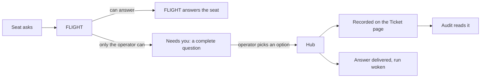

# Comms, Needs you and the FLIGHT fly-out: one message system, four clear places

**Status:** design, approved by the operator on 6 November 2026, amended the same afternoon (see
the amendment). Nothing here is built.
A line marked **(operator)** is something the operator said. A line marked **(controller's call)**
is the controller's choice, and the operator can change it.

## Intent

The message system is how the crew works. It is also the only way a question reaches the operator.

The operator used it on 5 November 2026 and it "didn't sit right at all" **(operator)**:

- The FLIGHT chat box took no text.
- Needs you was spread over narrow panes with too little context.
- Questions made no sense without knowing the project.
- Comms showed machine messages that looked like they were for the operator.

The operator wants **(operator)**:

- One place for questions. Each question is complete by itself: background, possible solutions,
  and pictures where they help. The operator picks an option or asks more.
- Mockups and flow diagrams shown with a question. The question is tracked against a ticket.
- A short way to ask FLIGHT about something seen on any page.
- Comms as the record: who messaged the team and what was said about a ticket.
- A way to reply to one message from an agent.
- Audit and logs tied to a ticket or PR, so a problem can be traced.
- A Needs you list that can be filtered, and ordered by priority or date.

## Amendment, 6 November afternoon: only what needs an answer

The operator approved this design in the morning. In the afternoon they read the live pages and
said **(operator)**:

- Needs you holds items that need the operator's answer. It is not a place for things to wait.
- A purposely held item does not sit in Needs you. It goes back to the Backlog with the right
  labels and a comment, or it is removed.
- FLIGHT checks that every item makes sense before it reaches the operator. If it does not make
  sense to FLIGHT, FLIGHT sends it back.
- Notifications in Comms do not help. Whoever responds to one clears it.
- Fewer notifications. Needs you is the only place the operator needs to see open questions.

This section changes the rest of the design where they differ. The sections after it are updated
to match.

### What the operator saw at 16:05

13 items counted in Needs you. One was a question only the operator could answer: PR 1423, two
page designs in one item, with raw `127.0.0.1` addresses.

| Items | What they were | Why they showed |
|---|---|---|
| 3 | "For the controller:" requests to check PRs | FLIGHT labelled them `blocker`. Every labelled Comms message is the operator's (`apps/server/src/hud.ts:1166`). A `blocker` stays theirs after 45 minutes, because `blocked` is a stuck kind (`hud.ts:889`, `hud.ts:1347`) |
| 2 | "FLIGHT is not triaging"; "FLIGHT left 1 wake reason … `wait_over:PR 1463:1793914200000`" | Hub alarms about FLIGHT, owned by the operator on purpose (`hud.ts:1397`). The second shows raw signal ids (`apps/server/src/flight/watch.ts:268`) |
| 3 | Issues of autonomy-engine (the studio loop's repo), 115, 115 and 14 days old | The loop is paused by its own issue, autonomy-engine#1818. The hub reads a pause only for `ta-loop` loops (`hud.ts:277`) |
| 3 | "PR #n · You: review" | Ended-run PRs under the operator's login. FLIGHT's brief said they were FLIGHT's, but the owner stayed the operator |
| 1 | #1503, a one-line `package.json` change | A tooling call within FLIGHT's and the controller's power |
| 1 | PR 1423, two page designs | A real question |

The Comms bell showed 27 "mentions": every direct message to CAPCOM, nearly all "For the
controller". Only "Mark all read" cleared it.

### How Teams does it

Microsoft Teams keeps three things apart. Mission Control copies the split:

| Teams | What it holds | Mission Control |
|---|---|---|
| Approvals | Requests that need your yes or no. Open ones on top; answered ones kept with their outcome | **Needs you**. Answered questions one filter away |
| Activity feed | A notice when something new needs you or is addressed to you. Opening it clears it | A browser notice for a new question or alert. One unread mark on what is addressed to the operator |
| Channels | The record. Bold when there is something new, no notification by default | **Comms** |

In Teams a request is closed by acting on it, not by reading a list of it. The same holds here.

### From a seat's side

1. Before asking, the seat reads its ticket, the ticket's decisions (in its start brief), the
   spec and `docs/direction.md`. If the answer is there, it uses it.
2. It asks FLIGHT with `ask_flight`, never the operator. The question says what is blocked, what
   it tried, the options it sees, and which it would pick. The hub stamps the ticket, run and commit.
3. It keeps working on the parts the question does not block. A run parks only when nothing is left.
4. If FLIGHT sends the question back, the seat rewrites it, or decides as FLIGHT says.

### From FLIGHT's side: FLIGHT is the gate

For every seat question, and every item the hub raises that is not protected, FLIGHT works down
this list. It stops at the first step that fits:

1. **Does it make sense?** If FLIGHT cannot state the question, the options and why they matter,
   it sends the question back to the seat with what is missing. The tool is new: `return_question`.
   For a hub item FLIGHT cannot explain, FLIGHT files the fault. The item still follows the
   steps below.
2. **Answered already?** The spec, the ticket, a past decision or `docs/direction.md` answers it.
   FLIGHT answers the seat.
3. **FLIGHT's call?** Flow, the order of work within the board's priorities, rework, tooling, and
   merges FLIGHT may clear. Not FLIGHT's: anything in the "needs the operator's yes" row of
   "Where today's items go". FLIGHT decides, logs it, and tells the seat. FLIGHT decides or asks,
   never both: no "unless you object" clock.
4. **A wait, not a question?** Waiting on CI, a PR, a date or another ticket goes on FLIGHT's
   watch list on the FLIGHT page.
5. **Only the operator can decide.** Money, product direction or taste, security, something that
   cannot be undone, or anything in the "needs the operator's yes" row. FLIGHT writes one complete
   question (rule 4). The test: someone new to the project could answer it from that page alone.

**Protected items always reach the operator.** These are the items the hub already protects
(`protectedDecisionItem`, `apps/server/src/attention-holds.ts:197`): approvals, the safety stop,
merging a change to the files that steer the crew, an Update only a person can run, an account at
its limit. FLIGHT adds a brief. It cannot hold them back, return them or withdraw them. Hub code
enforces this.

**When a question closes without an answer.** The hub closes it on a recorded fact: the ticket
closed, the PR merged or closed, the asking run ended. FLIGHT may also withdraw a question it wrote
itself, when it is not protected, with one line saying why. A closed or withdrawn question shows
under Answered with its reason. The waiting seat is told.

**Checking that a question still stands.** Hub code watches each open question's ticket, PR and
run. It wakes FLIGHT only when one of them changes.

### From the controller's side

- Requests for the controller go to the controller's own address (rule 1), not to the operator.
- A request names what it is about: a PR, a check or a ticket. The hub closes it when that happens,
  for example when the check is recorded or the PR merges. A reply or a "done" from the controller
  also closes it.
- A request unanswered past a set time is an Audit row. It reaches the operator only when the
  operator alone can act. #1450 (FLIGHT clears every check itself) removes most of these requests.

### From the operator's side

- **Needs you** shows open questions and nothing else. Each question offers: pick an option, ask
  FLIGHT more, **Not now**, or **Drop**.
- **Not now** sets a question aside for later. It is offered only on a question with a crew ticket
  that is not protected.
  - If a run is waiting on the question, the hub ends that run with a handoff and frees its seat.
  - The ticket moves to the Backlog. It gets the label `waiting:operator` and one GitHub comment
    with the question, the options and the date.
  - The question leaves Needs you. It stays on the Ticket page, with its options, so it can be
    answered there.
  - FLIGHT does not promote a `waiting:operator` ticket. It moves back when the operator answers
    the question or moves the card.
- **Drop** removes the work. Same conditions as Not now, plus the refusals of FLIGHT's close
  tool: no open PR and no open dependants. The ticket closes as not planned, with one comment.
- **Alerts** show only when the operator alone can fix something:
  - FLIGHT will not start;
  - an Update only a person can run;
  - an account at its limit;
  - FLIGHT left a wake undecided twice. The alert is in plain words, such as "FLIGHT has not
    decided what to do about PR 1463 since 14:30".

  A single late wake goes to FLIGHT's watch list, because the hub restarts and wakes FLIGHT itself.
- **Comms** is the record. It sends no notifications, and the bell goes. A message addressed to the
  operator shows an unread mark until it is opened. A message addressed to anyone else, the
  controller included, never does.
- **Browser notices:** a new question and a new alert. Nothing else.
- **What FLIGHT decided** shows on the FLIGHT page. The operator can reverse it from the fly-out.

### Loops Mission Control only watches

A watched loop's issue reaches Needs you only as FLIGHT's complete question. A watched loop states
in config how it is paused: a stop file, or the issue that pauses it. While it is paused, its other
issues stay on its card. The card shows the pause issue: "Paused by autonomy-engine#1818", with
its link. That issue is how the operator resumes the loop.

### How we know it worked

- Most questions are answered with an option on first opening, with no question back.
  Audit counts questions answered by an option, by Not now, by Drop, and those asked about first.
- No open question waits on a fact that has changed without FLIGHT having been woken about it.
- The operator sees no Comms notice for a message addressed to someone else.
- The controller checks by hand once a week: every item in Needs you passes the cold-read test.

## Amendment, 7 November: entry rules

On 7 November Needs you showed 11 items. None of them was a complete question for the operator.
They included "PR #1412 · You: review", a FLIGHT alarm with raw ids, three studio loop issues
over 100 days old, and an item FLIGHT had marked "None for the operator." The operator said
**(operator)**:

- Anything that reaches Needs you follows standing rules, with a hard check on what gets in.
- Text that does not say what the operator must decide goes back to whoever raised it.
- The page is simple and easy to read. Each item shows its title, when it was raised, what the
  operator must decide and the options the asker gave.
- The ticket and the PR are pinned to the item and linked by default.
- Pictures show when the question is about how something looks.

### The entry rules

Hub code checks every item before it counts in Needs you (`packages/core/src/needs-you-entry.ts`,
#1543). An item counts only when it is one of these:

1. **A hub alert the operator alone can act on.** Hub code writes its words. The alerts:
   - FLIGHT is not triaging;
   - FLIGHT left a wake undecided twice;
   - an Update only a person can run;
   - the runaway breaker tripped;
   - a run stopped on a budget or account limit;
   - an account at its rate limit;
   - a safety stop: new runs paused for the machine, the CLI held, upgraded or rolled back, a
     seat's focus that could not be imported;
   - the operator's own queue reorder, whose choices the hub writes.
2. **FLIGHT's complete question.** FLIGHT's brief for the operator, with all of these:
   - a question: one sentence that asks, ending in `?`, at most 300 characters;
   - no web address, raw signal id, raw timestamp or `[tag]` prefix in the question;
   - 2 to 4 options, each with a label and what happens if chosen; a person's message may offer
     suggested replies instead;
   - a recommendation;
   - the ticket or PR it is about: the item's own, or one FLIGHT names with `ticket`;
   - the time it was raised.

Rule 4's further parts (title, priority, picture for a looks question) join this check when #1510
lands. The check is one function, so each later rule is one more line in it.

### What happens to an item that fails

- **FLIGHT's brief is refused when written.** `brief_item` for the operator names each failed rule,
  so FLIGHT fixes it in one try.
- **FLIGHT's own question** for a decision with no item: FLIGHT asks it with `@CAPCOM`, its digest
  lists the item that raises, and FLIGHT briefs that item. A raw `@CAPCOM` question never reaches
  Needs you. A further `@CAPCOM` question after the brief sends the item back to FLIGHT until one
  brief covers every question still open; until #1546, FLIGHT has one such item open at a time.
- **Anything else that fails goes to FLIGHT.** Protected items are included. The item carries the
  failed rules, and FLIGHT's state lists them. It does not count in the operator's tab.
- **FLIGHT keeps, answers or briefs it.** A wait goes on FLIGHT's watch list. A question FLIGHT
  cannot state goes back to the seat (#1532).
- **When FLIGHT is not triaging,** failed items are counted under the one "FLIGHT is not triaging"
  alert. The operator learns that work waits, and starting FLIGHT is the fix.
- **FLIGHT's window** for a returned item starts when FLIGHT could first see it: raised, briefed,
  released from a hold, FLIGHT live or the hub started. A rollout is not "late" at once.
- **An item the operator already read** is dealt with when it is ordinary. When it is protected,
  FLIGHT still owes it a brief, and its digest lists it.
- **With no FLIGHT seat** the check does not apply. Rule 3's exception stands.

### The page, simplest form

The list shows each item's title, the date and time it was raised, and who raised it. The open
item shows, top to bottom:

1. **Title.** The ticket's or PR's title, in plain words.
2. **Raised:** date and time, then the age ("Fri 6 Nov 17:23 · 7 h ago"), and who asked.
3. **What you need to decide:** the question in one sentence.
4. **Options** as the asker gave them, each a button with what happens if chosen. The recommended
   one is marked with its reason.
5. **Pinned links:** the ticket and the PR, each with its number and title, opened by default.
6. **Pictures,** large, when the question is about how something looks.
7. **Ask FLIGHT,** beside the question.

What FLIGHT checked and who it asked sit below, one line each. Raw item text, "FLIGHT's view" and
"What FLIGHT did" lists leave the first screen. This replaces item 8 of "The open question, in
reading order" below.

## Words

One name for one thing, in this document and in the app.

| Word | Meaning |
|---|---|
| Operator | The person running Mission Control. Called CAPCOM in the app |
| FLIGHT | The head agent. It runs the crew and is the only agent that asks the operator |
| Seat | One crew agent, such as a developer or a reviewer |
| Run | One seat's work on one ticket, from start to end |
| Hub | Mission Control's own server. It is not an agent and not a person |
| Controller | A Claude Code session outside the crew that helps on this repo. Other repos have none |
| Question | Something only the operator can decide. In code it is a brief on a Needs-you item |
| Alert | The hub or FLIGHT cannot work until the operator acts |
| Message | Anything a person or agent sent |
| Notice | A message the hub wrote itself |
| Handoff | What one run leaves for the next run on a ticket |
| Not now | The operator sets a question aside: its ticket goes to the Backlog, labelled `waiting:operator` |
| Drop | The operator removes the work: the ticket closes as not planned |
| Fly-out | The FLIGHT chat panel that opens over a page. The code calls it the dock |

## What the controller found on 6 November 2026

The controller read the live hub at commit `47c1f5bd`.

| Finding | Evidence |
|---|---|
| Comms carries the crew | 210 messages in 24 hours: 81 between FLIGHT and seats, 44 seat to seat, 34 hub to seat, 51 to or from the operator's name |
| The operator's name is on machine messages | 23 of 26 messages sent as `CAPCOM` came from the controller. 22 of 25 sent to `CAPCOM` start "For the controller:" |
| Needs you is mostly not questions | 10 items, 1 real decision. The rest: 3 old items from stopped loops, 3 "PR · You: review" rows, 2 notices that FLIGHT was late, 1 reminder for the controller |
| The one real question did not stand alone | Its headline held four raw `127.0.0.1` addresses. Its options assumed the reader knew two ticket numbers |
| Picking an option names no option | `apps/web/src/shell/ItemDetail.tsx:192`. To a seat it sends chat text. To FLIGHT it posts in the item's discussion |
| An answer to a seat is stored, not delivered | `apps/server/src/comms.ts:118`. The seat reads it at its next turn. The route can deliver to the asking run, but the page never names the question |
| A seat's question is not on its ticket | The text is in `seat_questions`, which has no ticket. Comms holds a pointer line only |
| A question can show only pictures the hub already holds | `apps/web/src/needs/pictures.ts`. A new mockup image has nowhere to be stored |
| At least three ways to type to FLIGHT | The fly-out posts a seat message. Comms posts a stored message. A Needs-you item posts to its own discussion |
| The fly-out is left off three pages | `apps/web/src/App.tsx:155`. Comms, FLIGHT and Needs you have none. This was a decision; see "What this changes" |
| A dead chat box can look live | `apps/web/src/shell/Dock.tsx:151`. Until FLIGHT's state loads, the box is off but shows its usual hint |
| Hub messages read as log noise | The Comms copy of a CI failure is the first 1,200 characters of the log excerpt |
| The hub's conversation does not open | `/api/comms/agents/<seat>/contacts/MC` answers 404 (`apps/server/src/api.ts:2013`) |

## Goals

1. Each place has one job. The operator can say which place to use for what.
2. A question for the operator stands alone, offers choices and can show pictures.
3. A choice sends its bound answer to the run that asked, and the ticket's history records it.
4. Every message says who sent it: the operator, the controller, FLIGHT, a seat or the hub.
5. Everything said about a ticket or PR can be read on one page.
6. No text box looks live when it is not.
7. Keeping the record costs the agents no extra tokens.
8. The record outlives any one session.

## Non-goals

- A redesign of the Audit page or the Comms graph.
- The cross-machine rooms from the agent-comms spec. See "Rooms".
- Phone layouts.
- One new table for everything. The rules matter; the storage is the developer's choice.
- Picture upload by the operator. FLIGHT can open the page the operator is on.
- A change to the activity log. Its rows already link to tickets.

## Anti-goals: it fails even if it works when

- a question needs project knowledge the reader was not given;
- a question for the operator can be answered in a second place;
- an option click only sends chat text;
- a machine's message carries the operator's name;
- the Needs you count includes something that does not wait on the operator.

## The four places

| Place | The question it answers | What the operator does there |
|---|---|---|
| **Needs you** (page) | What needs my decision? | Reads a complete question, picks an option, asks more, sets it aside (Not now) or drops it |
| **FLIGHT fly-out** (every page) | Can I ask FLIGHT about this now? | Types a short question about what is on screen |
| **Comms** (page) | Who said what, and to whom? | Reads the record, replies to one message |
| **Audit** (page) | What went wrong, or might? | Reads problems, each linked to its ticket or PR |

A question is answered on the Needs you page only. Other pages show a count or a chip that opens it.

## How a question travels

Seats ask FLIGHT, and FLIGHT asks the operator. That rule from #758 (seats ask FLIGHT) stays. The
hub can also write a question itself, such as a queue change to approve. It meets the same rules.

## Rules the hub keeps

These live in hub code, not in prompts, so they hold for any model.

### 1. Senders are named for what they are

Every message records a sender kind: `operator`, `controller`, `flight`, `seat` or `hub`.

- The hub sets the kind from how the request was made, never from the text.
- `operator` means a person typed it in the app.
- The controller gets its own credential and its own name. It stops posting as `CAPCOM`.
- The controller keeps what it can do today: read, reply, pin, and mark a message done.
- A controller message wakes FLIGHT as an operator message does today.
- FLIGHT's actions through its operator tool are recorded as FLIGHT's.
- The hub's own messages get kind `hub`. Today some are sent as `MC` and some as `CAPCOM`. Examples, where the hub is the sender:
  `apps/server/src/crew-apply.ts:421`, `apps/server/src/engine/engine.ts:1226`,
  `apps/server/src/decision-defaults.ts:38` and `apps/server/src/instruction-notices.ts:44`. Every
  such place changes.
- Messages stored before this change keep their old sender.
- Rooms will add a sixth kind, for an agent on another hub.

Today FLIGHT is told that any line without the hub's prefix is the operator's. That is in its
start brief (`apps/server/src/runtime/brief.ts:422`). With this rule, FLIGHT is told which lines
are the controller's. The brief and FLIGHT's role file are hard-rule files, so the change needs
clearance.

### 2. A message about a piece of work carries its ticket

- The hub fills the ticket from the sender's run when the sender gives none.
- A fly-out line carries the ticket the operator has open, when there is one.
- New messages store one format: `repo#n`. Older rows stay as they are.
- A sender with no ticket of its own (FLIGHT, the operator, the controller) can still give one,
  as today. The hub also takes it from the message being replied to. A team message may have none.
- A seat's question to FLIGHT keeps its own record, with its full text, and gains the ticket. The
  Ticket page shows it from that record. The pointer line in Comms goes.

### 3. Needs you counts only what waits on the operator

An item waits on the operator only when it carries a complete question (rule 4). The table under
"Where today's items go" places every other kind.

The Needs you count is the number of open questions. Alerts have their own chip.

When a hub has no FLIGHT seat at all, a seat's question goes to the operator, an exception to
"FLIGHT is the gate". It must still pass rule 4. The page
marks it "asked by a seat, not checked by FLIGHT".

### 4. A question is complete or the hub refuses it

#759 (complete operator briefs) and its server ticket #1389 already set the contract. A question
has: the question itself, why it is the operator's, context, who FLIGHT asked, two to four
options, a recommendation, what happens with no answer, the cost of delay, and how fresh it is.
Each option says what follows and whether it can be undone.

This design keeps that contract and adds **(controller's call)**:

- **One decision per question.** Two decisions are two questions.
- **A title:** one line, at most 90 characters, no web address, no bare ticket number.
- **A priority,** using the board's Priority values. It comes from the main ticket. FLIGHT states
  one when the ticket has none.
- **One main ticket,** and any related tickets. With no ticket, FLIGHT names the repo and says why.
- **A picture or preview** on any question about how something looks (rule 5).
- **No raw addresses** in the title or the question sentence. Links go in the links list.

The hub shows every `#n` and `PR n` with its title beside it, so a number never stands alone.

The hub cannot judge whether the background is good enough. Two things cover that:

- The `plain-talk` skill tells FLIGHT how to write for a reader new to the project.
- Audit counts questions where the operator's first reply was itself a question (rule 9).

### 5. A question can show pictures and previews

Most of this exists since PR 1465 (the Needs you page). A picture is written in the question's
text, and the page shows it large when the hub holds the image. This design adds two things:

- **A store for a new image.** A seat or FLIGHT can give the hub an image file, such as a mockup or
  a flow diagram. The hub returns an address that works in a question.
- **The check in rule 4.** The hub reads the text for a picture, or finds a preview for the ticket.

A preview is a branch's build opened at full width, from #1454 and #1458 (branch previews). A
mockup is a branch preview, so it uses the real app's styles. The question's form does not change.

### 6. A choice is bound, delivered and recorded

- Picking an option calls the hub with the ids #1389 defines. Chat text never picks an option.
- **A seat asked:** the hub delivers the answer to that run and wakes it. #1474 (answers name
  their question) covers the page's part. FLIGHT is told.
- **FLIGHT asked for itself:** the answer goes to FLIGHT and wakes it.
- **The asking run has ended:** the answer goes to FLIGHT, which passes it to the ticket's next
  run. The hub never hands an answer straight to a different run.
- The hub closes the question and adds the question, the choice and the time to the ticket's
  history. Nothing is written to GitHub.
- The page shows a receipt: what was chosen, where it went and when it was delivered.

The operator can also write to FLIGHT in the question's conversation, to ask more or to propose
something else. That text never picks an option and never approves anything. FLIGHT answers, or
writes the question again with new options.

### 7. A message from the operator to a seat is delivered

A message or reply from the operator wakes a waiting seat. A working seat gets it at its next turn. The
message shows its state: stored, or delivered with the time.

If the run that wrote the message has ended, the page says so before sending. The reply then goes
to the seat now on that ticket, or to FLIGHT when there is none. This applies to replies only,
never to an answer (rule 6).

The hub stores an exact repeat once, for every sender. A second copy with the same sender,
recipient, ticket and text within a minute is not stored. The sender gets "already sent" and the
first copy's state, as a success. The hub counts each one for Audit. On 6 November one
message to a seat was stored three times in three seconds.

### 8. Hub messages are notices

- Kind `notice`, sender `hub`.
- The Comms copy is one plain line with a link: "CI failed on 341f108 in job web-core."
- The seat still gets the full log excerpt. The same ticket checks that it shows the failing test.
- Notices do not count as unread. One switch hides them.

### 9. Audit reads the same records

Each of these becomes a row in Audit's list of things to improve, linked to its ticket:

- a question where the operator had to ask what it meant;
- a question that waited longer than a set time;
- a reply or answer delivered after its run ended;
- two agents past six rounds on one ticket (the hub counts this today);
- the same message sent more than once;
- the same notice repeated on one PR;
- a request for the controller that waited longer than a set time;
- a ticket with far more message text than usual.

## Where today's items go

| Today in Needs you | Where it goes |
|---|---|
| A question FLIGHT or the hub wrote, complete by rule 4 | Stays |
| A person waiting on GitHub, with FLIGHT's suggested replies | Stays. The replies are the options |
| "FLIGHT will do this unless you object", with its 40-minute clock | Goes. FLIGHT decides and logs it on the FLIGHT page, or asks a complete question **(operator, 6 Nov pm)** |
| A held question | Goes. **Not now** moves its ticket to the Backlog, labelled `waiting:operator`, with the question on the Ticket page **(operator, 6 Nov pm)** |
| FLIGHT stopped and the hub cannot start it | **Alert.** It lists what waits behind FLIGHT |
| FLIGHT late, or a wake left without a decision | FLIGHT's watch and Audit. Not the operator's: the hub restarts and wakes FLIGHT |
| The hub needs an Update only the operator can run; an account has hit its limit | **Alert** |
| FLIGHT's safety stop tripped | Stays, as a question with bound choices, as #1389 defines |
| A request "for the controller" | Comms, addressed to the controller. If none answers in a set time, FLIGHT writes it as a question |
| A seat that stalled or failed, a stray process, a blocked test lock, a PR nobody is moving | FLIGHT's queue, shown on the FLIGHT page. FLIGHT fixes it or writes a question |
| A question from a loop Mission Control only watches | FLIGHT's queue until FLIGHT writes a complete question. Hidden while the loop is paused, including by its own pause issue |
| The Comms Mentions bell | Goes. One unread mark on a thread where someone replied to the operator |
| Something that needs the operator's yes: merging a change to the files that steer the crew, reordering the work queue, a safety approval, accepting tested work, more budget | Stays, written as a complete question. The hub writes it where it raises the item today |
| Something that reports state: work in review, work ready, work waiting on other work, a tool error, a seat's message nobody answered | FLIGHT's queue |
| FLIGHT's lines addressed to the operator | The FLIGHT conversation, marked unread until opened |

**Alerts (controller's call).** A header chip on every page, shown only when there is an alert. It
opens a short list. Each alert has one link to the place that fixes it, such as Start FLIGHT. An
alert clears when its cause clears. Alerts send a browser notice, as "FLIGHT is down" does today.

## Tracking that costs the agents nothing

The record is there to cut token use and to show who did what **(operator, 6 November)**. It must
not become a place where agents spend tokens writing or scanning.

**What the controller measured.** From the Claude seats' transcripts for the 24 hours to
6 November:

| Tool | Calls | Text returned | Note |
|---|---|---|---|
| `comms_read` | 25 | 318,000 characters, 12,700 a call | 9 calls hit the 20,000 cap. The crew sent 83,000 characters that day, so it was read about four times over |
| `comms_inbox` | 22 | 83,000 characters, 3,750 a call | Only what is addressed to the seat |
| `comms_send` | 54 | 29,000 characters written | 530 a message |
| `ask_flight` | 13 | 7,800 characters written | |

`comms_read` is the waste. It returns the newest 50 messages across the whole crew with no
filter, so most of what a seat reads is about other tickets. RETRO-1 (a reviewer seat) called it
12 times, once a review.

**Pins are mostly there, in two forms.** In the same 24 hours no seat message lacked a ticket.
A count an hour after the table at the top found 219 messages. 38 stored the short form
(`#1458`) and the rest the long form (`mission-control#1458`). So one ticket's messages sit under
two keys. 23 of the 26 messages sent
as the operator had no ticket at all.

### The hub stamps every message; the agent types the recipient and the text

A seat's token is tied to one run, so the hub already knows everything below when a tool is
called. The agent gives the recipient and the text. It adds one word, the label, when the
message must wake someone.

| Field | Set by | From |
|---|---|---|
| Sender and sender kind | Hub | The seat's token, or the app session (rule 1) |
| Run | Hub | The token |
| Ticket and PR | Hub | The run's ticket and its open PR (rule 2) |
| Kind, for rows the hub writes | Hub | The tool that was called: `ask_flight` is a question, `answer_question` is an answer, a report tool's Comms line is a short note pointing at the report, the engine's line is a notice |
| Label: question, handoff or blocker | Agent | Unchanged from today. Any label wakes an idle seat. A question or blocker also starts the clock that passes it to FLIGHT after 15 minutes with no answer |
| Commit | Hub | The run's newest commit, when the hub knows it **(controller's call)** |
| Delivered, answered | Hub | When it put the message in a prompt; when a reply or answer closed it |
| Reply-to | Agent | One id, only when replying. The id is on the row being answered |
| To, text | Agent | |

A seat's actions are tracked the same way and already are: taking a ticket, a commit, a push, a
PR, a CI result, a review round, a merge. The hub writes those as events. With the messages they
make one timeline for the ticket.

### What an agent uses, and what is left out

A field earns its place when the hub can stamp it and it lets an agent ask for less.

| Field | What it saves |
|---|---|
| Ticket and PR | The agent reads one ticket's thread, not the crew's |
| Kind | It can ask for decisions and open questions and skip chatter |
| Answered or open | It sees what still waits on it, as a list, not a log to re-read |
| Commit | It can tell a finding about an old commit from a current one |
| Sender kind | It knows an operator's decision from a seat's suggestion or a hub notice |
| Delivered | It does not send the same message again |

Left out on purpose: anything an agent would write about its own message, such as urgency,
confidence or tags. That costs tokens and cannot be trusted. Token counts are for Audit and
people, and are not sent to agents.

### Reading is by ticket, short first

- **The hub sends each message to a seat once.** Today it attaches the newest 40 inbox messages,
  read or not, to a run's start. It attaches them again to each line it delivers between turns,
  up to 8,000 characters (`apps/server/src/comms.ts:123`).
- **A run starts with its ticket's decisions.** Every run on a ticket gets the ticket's answered
  questions in its start brief. Each is one line with the choice, ten at most **(controller's
  call)**. A decision is then not asked twice. A run that takes over unfinished work also gets the
  handoff, as today. It holds the goal, what is done, what is left and the last six messages.
- **`comms_read` reads one ticket.** It defaults to the seat's own ticket and can filter by kind.
  Each message comes back as one line of at most 200 characters **(controller's call)**. The agent
  asks for a full text by id when it needs one. A seat can still ask for the team channel or
  another ticket by name. FLIGHT has no ticket, so its default is the short form across tickets.
  The pushed inbox keeps full text.
- The role files tell seats to read by ticket. Role files are hard-rule files, so that change
  needs clearance.

Four smaller points:

- The Comms copy of a notice is one line, so a later read does not pay for log text again.
- Hub code works out the Audit rows. No agent reads messages to find them.
- Delivering an answer to a seat does not wake FLIGHT. FLIGHT sees one line at its next wake.
- A refused question names the missing part, so FLIGHT fixes it in one try.

### No model reads messages to sort them

The operator asked whether a small model such as Haiku should check each seat's messages. The
answer is no **(controller's call)**:

- After item 1, hub code picks a seat's messages by address, ticket and kind. That costs no tokens.
- A model in that path adds a call, and a summary can lose an exact id or error text.
- What is left is small. A seat's inbox averaged 3,750 characters a read.
- In front of FLIGHT it would not pay either. The hub counts a wake as idle when no decision
  follows within four minutes. On 6 November that was 14 of 251 wakes. Starting sessions costs
  more: about half of FLIGHT's spend since 22 October, by the hub's own figure. The token audit
  (PR 1502) covers that.

### Also measured, and passed to Audit

These are agent reports, not messages, so this design does not change them. The controller files
them as Audit rows with the figures. Each is for the same 24 hours.

| Tool | Calls | Text | What stands out |
|---|---|---|---|
| `report_findings` (a reviewer's report) | 79 | 811,000 characters written, 10,000 a call | The largest text the crew writes. What it checked is 154,000; what works well is 43,000 |
| `report_evidence` (a developer's report) | 140 in 29 runs | 388,000 characters written | 39% of the Done-when text repeats the report before it |
| `read_ticket` | 71 | 433,000 characters returned, 6,100 a call | Not looked into |
| `preview_browser` | 98 | 949,000 characters returned | Not looked into |

## Kept outside any session

- The record lives in the hub's database, not in an agent's session. A new session or run gets
  what it needs from the hub.
- Today the hub deletes messages, FLIGHT's decisions, old briefs and answered seat questions
  after 90 days. It keeps runs, reviews and merged PRs for 365 days.
- The hub keeps questions and their answers for 365 days, like runs **(controller's call)**. The
  same holds for seats' questions to FLIGHT and the conversation on each. Messages and FLIGHT's
  own decision log stay at 90 days.
- Nothing new is written to GitHub, except Not now and Drop (see Security). A copy of each
  decision on the GitHub ticket is left out.

## The simple path for a person

A person does two things here, and each has one way in.

- **Answer a question:** the Needs you tab. Its count shows on every page.
- **See what was discussed:** click a ticket or PR number, on any page. It opens the Ticket page,
  with the whole history in time order. An answered question links to the same page.

The Tickets list in Comms gets a search box, for when the number is not known.

## How the pages get designed

Every page change goes through the `hud-design` skill and its dashboard reference,
`.claude/skills/hud-design/references/dashboard-layout.md` **(operator, 6 November)**. This
document sets what each place is for, what it holds and the reading order. It does not set a
layout. For each page that changes, the seat:

- names the page's question and reader, lists each panel's fields, and ranks the panels;
- sizes each panel from its content, at the viewports the reference lists;
- renders it busy, in the real app on a branch, and shows the operator before the build starts;
- lists anything dropped or moved.

**Dropped or moved by this design.** The operator agrees to these by approving it.

| Today | Change |
|---|---|
| Comms: the Decisions panel | Removed. Questions are on Needs you |
| Fly-out: the waiting list and summary | One line that opens Needs you |
| Needs you: alerts and FLIGHT's own items | The Alerts chip, and the FLIGHT page |
| Comms: unread counts per agent | Labelled as message counts |
| Comms: the Mentions bell | Removed. An unread mark on what is addressed to the operator |
| Needs you: the Held group and the Hold button | Removed. **Not now** and **Drop** |
| Needs you: "FLIGHT will do unless you object" | Removed. FLIGHT decides and logs it, or asks |

## Needs you page

Starts from the page PR 1465 added. This section sets what the page holds and in what order.
The layout is settled through the `hud-design` skill (see "How the pages get designed").

**The list**

- One group: open questions. The "FLIGHT will do unless you object" and Held groups go
  (see the amendment).
- **Filters (operator):** repo, priority, who asked. A search box for the text. Answered questions
  are one filter away.
- **Order (operator):** priority then oldest, by default. Also oldest, newest and soonest deadline.
- A question that seats are waiting on sorts first within its priority **(controller's call)**.
- Each row: title, ticket, priority, age, and "2 seats waiting" when that is true.

**The open question, in reading order**

1. Title, ticket, priority, who asked, age, and a mark when the question is out of date.
2. The question in one sentence, and why it is the operator's.
3. Background: what this is, what changed, why it matters now, and the cost of waiting.
4. Pictures, shown large in the main column. A click opens one at full size. **Open preview** shows
   a branch build.
5. Options as cards: what follows, and whether it can be undone. The recommended card is marked
   with its reason, and its button is the main one.
6. What happens with no answer.
7. Actions: pick an option, write to FLIGHT, **Not now** (the ticket goes to the Backlog).
8. What FLIGHT checked and who it asked. These stay open, not folded away.

The conversation stays beside the question, wide enough to read. Its box fills its space, which
#1478 (the conversation box ticket) fixes.

A question always opens on this page. The small item panel stays for items that are FLIGHT's.

**An example of a complete question.** One part of the 5 November design approval, as an
illustration:

> **Approve the new Agents page design**
> #1434 Agents page shows what a seat is doing · P0 · asked by FLIGHT · 31 hours ago
>
> **The question:** may the crew build the Agents page as shown?
> **Why you:** it changes what the product shows.
>
> **Background.** The Agents page shows one seat's work. Today it needs scrolling to see what the
> seat is doing. The new design fits it on one screen. It removes two figures, "Tokens this run"
> and "tokens so far". They leave out cached reads, so they mislead. Context and Cost stay.
> Waiting costs little: the page works today.
>
> *[picture: Agents page, seat working] [picture: Agents page, seat idle] [Open preview]*
>
> **Options**
> 1. **Approve (recommended).** A developer seat builds it next. Can be undone: yes, by a later PR.
> 2. **Approve, but keep the two token figures.** FLIGHT changes the design first. Can be undone: yes.
> 3. **Do not build it.** The ticket closes. Can be undone: yes, by reopening it.
>
> **Why FLIGHT recommends 1.** The two figures are wrong today, and the ticket is P0.
> **With no answer:** nothing is built. This is an approval, so it has no default.

**What Needs you is for (operator, 6 November).** It holds items raised from the seats' work:
blockers, questions, and choices that need a person. The operator does not start anything here.
The operator's own question goes to FLIGHT in the fly-out, or to a seat in Comms. If it turns
into new work, FLIGHT files a ticket for the planning seat. The planning seat's own questions
then reach Needs you the usual way.

## FLIGHT fly-out

**Job:** a short check-in from any page **(operator)**. FLIGHT has full access, so the operator asks
it in place of looking things up.

- Opens on every page with the same key (`f`) and header button.
- Holds the conversation only, at full height. The waiting list goes. One line says "3 questions
  wait" and opens Needs you.
- **Knows where the operator is (controller's call).** A chip above the box names the page and the
  open ticket or seat. It is sent with the message and can be removed.
- **The box always takes text.** The hub stores the message at once. A line under the box says:
  sent, delivered, or "FLIGHT is stopped", with a Start FLIGHT button. The hub delivers a stored
  message when FLIGHT starts.
- **One conversation.** The fly-out and Comms show the same thread, read the same way and posted
  the same way. The hub's thread read already joins stored messages with FLIGHT's own turn text.
- The box takes several lines. One send rule covers every box in the app. The mockup settles it:
  today the Needs you boxes send on Ctrl or Cmd with Enter, and the others on Enter.
- The mockup also settles the width, and whether the panel can sit beside the page.

## Comms

**Job:** the record **(operator)**. No question is answered here.

- **Left column:** Team, FLIGHT and you, Agents, Tickets. "FLIGHT and the controller" shows on a
  repo that has controller messages.
- The Decisions panel goes.
- Every message shows its sender kind as a tag: YOU, CONTROLLER, FLIGHT, a seat's name, HUB.
- The operator can message a seat directly, or **Reply** on one message. Both exist today. Both
  now deliver and show their state (rule 7).
- **By ticket.** The Tickets list filters the chat to one ticket's messages. That is a separate
  control from opening the ticket **(operator, 5 November)**.
- **Clicking a ticket number** opens the Ticket page, which exists today. It already joins runs,
  reviews, CI, FLIGHT's decisions and messages. It gains questions and their answers, the
  conversation on each question, questions set aside (Not now), handoffs and notices. It opens
  straight from Comms.
- Unread marks cover only what is addressed to the operator, never the controller's messages.
  Other figures are labelled as
  message counts.
- The hub's conversation opens.

## Rooms (not in this design)

`docs/superpowers/specs/2026-10-24-agent-comms-design.md` describes rooms shared across machines.
That code is in `packages/agentcomms` and `apps/relay`, and the hub does not use it yet. When it
does, a room shows in Comms beside Team. A question from a room follows rules 3 to 6.

## What this changes in earlier decisions

Each of these is a change, stated so nobody finds it by surprise.

| Earlier decision | Change |
|---|---|
| The roadmap (`2026-10-28-operator-console-roadmap.md`, decision 2): when FLIGHT is down or late, one Needs-you item says so | FLIGHT down, or a wake left undecided twice, is an alert in plain words. A single late wake goes to FLIGHT's watch list. This reverses `hud.ts:1397` for single late wakes only |
| The roadmap, plan item 12, and #1453 (the Needs you page): no fly-out on FLIGHT, Comms or Needs you | The fly-out opens on every page. It no longer repeats the FLIGHT page, because it holds the conversation only |
| #1390 (the complete brief shown on the page): Accept on Needs you, Comms and the item panel | Accept on the Needs you page only. #1390 is re-scoped before it starts |
| #1390: its file list | Out of date since PR 1465. The reading order above replaces it |
| #759: no new count model | The count change is its own ticket (item 3 below), not part of #759 |
| Requests "for the controller" (#765, now closed) | They go to the controller's address and clear by action (the amendment). They reach the operator only when the operator alone can act |
| #1453: Enter rule on the Needs you boxes | Unchanged until the fly-out mockup settles one rule |
| The roadmap, decision 1: one Needs-you set, counted the same everywhere | The count narrows to open questions, and the page shows only those. Held items and timed defaults leave the page; alerts have their chip |
| Timed defaults (#741, `apps/server/src/decision-defaults.ts`) | Retired for questions to the operator. FLIGHT decides or asks |
| Hold on a Needs-you item (#638: `apps/web/src/needs/HoldItem.tsx`, `holdItem` in `apps/server/src/attention-holds.ts`) | Becomes **Not now** and **Drop** for the operator. FLIGHT's own holds (its hold tool, and holds set through `brief_item`) move to its watch list |
| The roadmap, plan item 7: notices only for briefed asks and "FLIGHT is down" | Two more alerts send a notice: an Update the operator must run, and an account at its limit |
| The role files: use `comms_read` for missed crew context | Read by ticket |

#1389 is in rework now. The amendment re-scopes it, as in the table below. The extra checks in rule 4 are a new
ticket that follows it.

## Order of work

The controller files the tickets after approval. FLIGHT or the planning seat can split them.

**Open today**

| Ticket | Covers | Change |
|---|---|---|
| #1389 | The hub checks a question and binds each choice | Re-scoped: timed defaults stop for questions to the operator, so its default ledger serves FLIGHT's own decisions only |
| #1390 | The complete question shown on the page | Re-scoped, as above |
| #1458 | A branch preview opens from a question | None |
| #1464 | Remove the unused Asked-of-you file | None |

**First, from the amendment (controller's call).** These cut the noise with small changes. They go
ahead of the list below.

- **Who an item is for:** #1509 (Needs you counts only open questions). Its body is rewritten to
  match the amendment:
  - a Comms request for the controller is not the operator's;
  - a single late FLIGHT wake goes to FLIGHT's watch list; two undecided wakes are an alert in
    plain words;
  - a "You: review" PR no run owns is FLIGHT's;
  - a watched loop states how it is paused, and its card shows the pause issue;
  - Needs you shows one group, open questions.
- **FLIGHT is the gate:** #1532.
  - The five steps go into `roles/FLIGHT.md`, with the protected items.
  - `return_question` sends a question back to its seat.
  - The hub closes questions on recorded facts. FLIGHT withdraws only its own unprotected
    questions.
  - Hub code watches each question's ticket, PR and run, and wakes FLIGHT when one changes.
  - **Not now** and **Drop**, and FLIGHT's watch list on the FLIGHT page.
  - Timed defaults stop for the operator's questions.
  - The seats' roles say how to ask FLIGHT. The `plain-talk` skill's defaults rule applies only
    between agents.
- **Requests clear by action:** #1513 (Comms is the record).
  - The Mentions bell goes.
  - A request names its PR, check or ticket, and clears when that happens, or on a reply or "done".
  - An unread mark only on what is addressed to the operator.
- **Rule 4 reads every field the page shows.** That covers the question's source text, FLIGHT's
  basis and what it checked, not only the title. This goes to #1510, the question checks. Raw
  source text is shown folded away as "Source".

**New, in this order (controller's call)**

1. Tracking that costs nothing: the hub stamps run, ticket, PR and kind; one ticket format;
   `comms_read` by ticket, short first; a run gets its ticket's decisions at the start; decisions
   kept for 365 days; each inbox message pushed once; the exact-repeat guard. First because it
   saves tokens now and the rest reads from it.
2. Senders named for what they are, with a tag on every message (rule 1).
3. Needs you counts only questions; the Alerts chip; filters and order (rule 3, the list).
4. Title, priority, ticket and picture checks, and the image store. Follows #1389 (rules 4, 5).
5. Answers and messages are delivered, with their state shown (rules 6, 7).
6. The fly-out on every page, one FLIGHT conversation, a box that always takes text.
7. Comms: sender tags, no Decisions panel, the unread rule, the hub conversation, ticket search;
   the Ticket page gains the missing kinds.
8. Notices in plain words (rule 8).
9. Audit rows for message problems (rule 9), and for the four tools under "Also measured".

Item 1 is filed as #1506. Item 4 needs #1389 merged. Item 5 needs #1474.

Items 3, 6 and 7 change a page's layout. Each follows "How the pages get designed" before its
build starts. Items 2, 5 and 8 add small visible parts: a tag, a state line, a switch. They
follow the `hud-design` checklist.

## How we know it worked

- The controller checks by hand, for a week, that the count equals the real questions.
- No message is recorded as the operator's unless the operator typed it.
- The share of questions answered with no clarifying message rises. Audit shows it.
- Audit shows the time from an answer to its delivery.
- A browser test covers each text box: it takes text, or it says why not.
- Text returned by `comms_read` falls from 318,000 characters a day. The controller measures it
  again a week after item 1 ships.
- Comms tokens per merged ticket do not rise. Audit shows the figure.

## Security

- One new GitHub write, from the operator's own click. **Not now** moves the ticket's card to
  Backlog, adds the label `waiting:operator` (created once per repo) and posts one comment. **Drop**
  closes the ticket as not planned with one comment, under the same refusals as FLIGHT's close
  tool. Both act only on a crew ticket of the hub's own repo, never on a protected item.
- Protected items cannot be held back, returned or withdrawn by FLIGHT. Hub code enforces it.
- The controller's credential grants nothing new. It labels what the controller already does. An
  agent with shell access on this Mac could still read the operator's token, as today. Sender
  kinds make honest traffic clear. They are not a defence against that.
- A choice acts only through the bound path #1389 defines. Chat text never runs one.
- The image store takes image files only, with a size limit, and scans nothing as code.
- Pictures show only from hub storage. Links follow the safe-link rules from PR 1465. A preview
  runs on its own address, as #1458 sets out.
- A stored message for a stopped FLIGHT goes only to FLIGHT, on its next start.
- Items 1, 2, 4, 5 and 8 change hard-rule files. These are the seat tools, the engine, FLIGHT's
  tools and start brief, the question checks, and the role files. Each needs clearance.

## Left to the developer

- The storage shape, so long as the rules hold.
- How the hub tells a controller request from an operator request.
- The limits behind "a set time", as config with stated defaults.
- The image store's route and size limit.
- How the Ticket page is reached in the nav.
- The exact form of `comms_read`: its filters, the one-line form, and the read by id.
- Who marks a question as being about how something looks.
- Which notification category an alert uses, and whether quiet hours hold it.
- What a reply does when its seat has no live run or the crew is paused.
